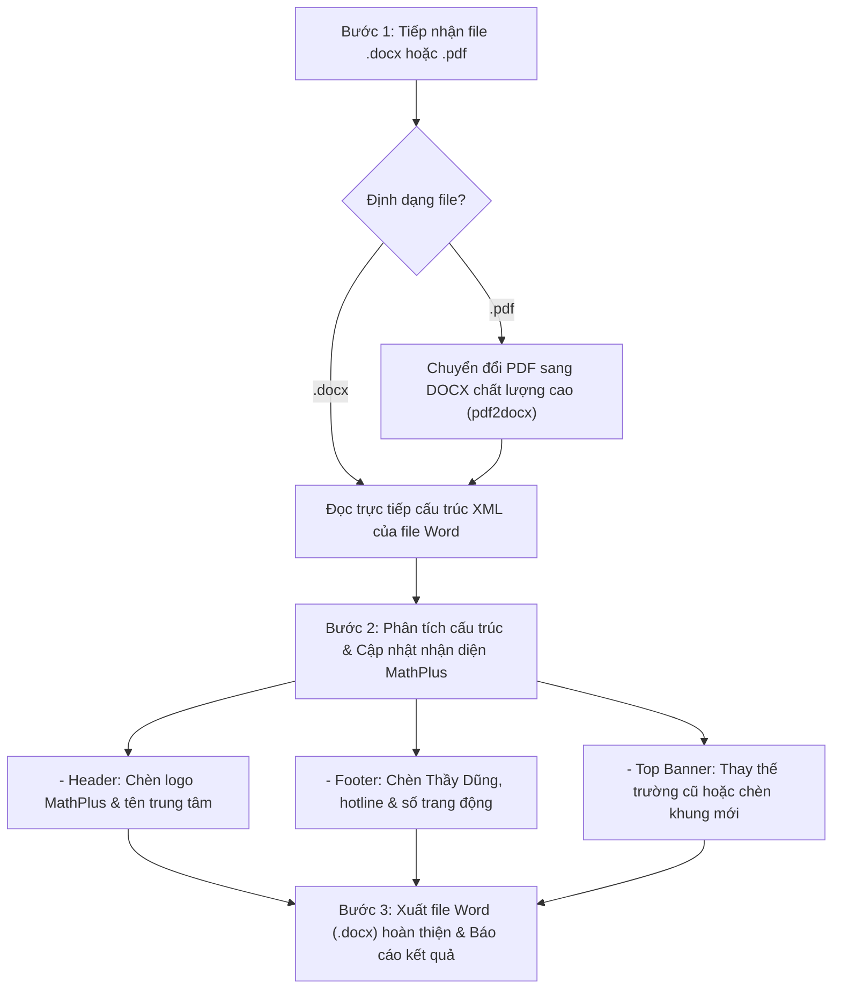

# MathPlus Add Logo: Bộ Công Cụ Đóng Dấu Thương Hiệu & Thông Tin Thầy Dũng

## 1. Tổng quan & Mục đích

Skill `mathplus-add-logo` cung cấp năng lực tự động chuẩn hóa thương hiệu và gắn bản quyền cho mọi tài liệu đề thi, phiếu bài tập, đề cương ôn tập môn Toán của **Trung tâm MathPlus Academy**:

- **Đầu vào linh hoạt**:
  - Tệp Word (`.docx`, `.doc`).
  - Tệp PDF (`.pdf`) từ các trường, sở giáo dục, tài liệu tham khảo trên mạng hoặc nội bộ.
  - Xử lý một file đơn lẻ hoặc hàng loạt toàn bộ file trong thư mục.
- **Đầu ra chuẩn mực**:
  - File Word (`.docx`) giữ nguyên **100% nội dung gốc**: bảo toàn công thức toán (OMML / MathType), hình vẽ hình học, bảng biểu, hệ trục tọa độ, đáp án và căn lề.
  - Tích hợp nhận diện thương hiệu MathPlus Academy:
    1. **Logo MathPlus Academy**: Logo nguyên màu gốc độ phân giải cao được chèn tinh tế vào Header và/hoặc Top Banner.
    2. **Thông tin giáo viên Thầy Dũng**: Ghi rõ giáo viên phụ trách biên soạn `Thầy Nguyễn Văn Dũng – Hotline: 0977 961 189`.
    3. **Hệ thống Header & Footer**: Tự động đánh số trang động `Trang [PAGE]`, hiển thị Hotline và tên trung tâm trang nhã ở tất cả các trang.
    4. **Top Banner (Bảng nhận diện trang 1)**: Tự động phát hiện và chuyển đổi khung trường/sở cũ thành khung MathPlus Academy hoặc chèn mới khung họ tên học sinh kèm thông tin Thầy Dũng.

---

## 2. Quy Chuẩn Nhận Diện Thương Hiệu MathPlus

1. **Logo MathPlus**:
   - Sử dụng file logo gốc tại `resources/logo.jpg` (hoặc `C:\code\mathplus\public\images\logo.jpg`).
   - Giữ nguyên màu sắc gốc của logo (xanh lá `#0F8A3C` + cam ấm `#EA580C`), tuyệt đối không biến đổi sang đen trắng.
   - Kích thước:
     - Header các trang sau: rộng `7.5 mm` (nhỏ gọn, thanh lịch, đặt cạnh chữ in nghiêng).
     - Top Banner trang đầu: rộng `18.0 mm` (nổi bật, cân đối với khung tiêu đề).
2. **Thông tin giáo viên & Liên hệ**:
   - Tên giáo viên: `Thầy Nguyễn Văn Dũng` (hoặc `Nguyễn Văn Dũng`).
   - Tên trung tâm: `Trung tâm MathPlus Academy`.
   - Hotline: `0977 961 189`.
   - Website: `mathplus.com.vn`.
3. **Typography & Màu sắc**:
   - Phông chữ chuẩn: `Times New Roman`.
   - Cỡ chữ: Tối thiểu `10.5pt - 11pt`, không dùng cỡ chữ quá nhỏ gây khó đọc.
   - Màu chữ: Màu Đen tuyền `RGBColor(0, 0, 0)` (`#000000`), nền trắng hoàn toàn.
4. **Cơ chế đánh số trang**:
   - Đánh số trang tự động bằng mã trường Word bản địa (`w:fldChar` mã lệnh `PAGE`).
   - Căn lề phải ở chân trang (Footer), không bị lệch dòng khi thêm bớt nội dung.

---

## 3. Quy Trình Vận Hành 3 Bước của Agent



### Bước 1: Tiếp nhận và xác định định dạng
- Kiểm tra đường dẫn file do người dùng cung cấp.
- Nếu là thư mục: Duyệt tất cả các file có đuôi `.docx`, `.pdf` trong thư mục (loại trừ các file đã có hậu tố `_mathplus.docx`).
- Nếu là file `.pdf`: Gọi module chuyển đổi `pdf2docx` tạo file DOCX tạm thời để giữ nguyên mọi bảng biểu, khối toán và hình ảnh.

### Bước 2: Bơm nhận diện MathPlus & Thầy Dũng
- Mở file `.docx` bằng `python-docx`.
- **Top Banner**:
  - Quét xem 2 phần tử đầu tiên của tài liệu có bảng tiêu đề của trường/sở cũ (chứa các từ khóa `TRƯỜNG`, `SỞ GD`, `PHÒNG GD`, `UBND`, `THPT`...) hay không.
  - Nếu có: Giữ nguyên cột tiêu đề đề thi bên phải và chuyển đổi ô bên trái thành Logo MathPlus + thông tin trung tâm, đồng thời bổ sung dòng `Giáo viên phụ trách: Thầy Nguyễn Văn Dũng – Hotline: 0977 961 189` vào ô bên phải.
  - Nếu chưa có: Tạo bảng 2 cột mới (cột trái: Logo + MathPlus, cột phải: Khung điền thông tin học sinh & Thầy Dũng) và chèn lên vị trí đầu tiên của tài liệu.
- **Header**:
  - Trang đầu: Để trống (nếu đã có Top Banner) hoặc đặt logo + Hotline.
  - Trang 2 trở đi: Đặt Logo MathPlus nhỏ (`7.5mm`) và tên `Trung tâm MathPlus Academy` căn lề phải.
- **Footer**:
  - Áp dụng cho toàn bộ các trang:
    `Giáo viên: Thầy Nguyễn Văn Dũng – Trung tâm MathPlus Academy  |  Hotline: 0977 961 189` (bên trái) và `Trang [PAGE]` (bên phải).

### Bước 3: Đóng gói và lưu file
- Lưu file mới theo quy ước: `[Tên_gốc]_mathplus.docx` (hoặc lưu vào thư mục chỉ định).
- Trả về đường dẫn file clickable link dạng `file:///` cho người dùng.

---

## 4. Cấu Trúc Thư Mục Skill

Thư mục skill đặt tại: `C:\Users\nguye\.gemini\config\skills\mathplus-add-logo\`
```
mathplus-add-logo/
├── SKILL.md                          # Tài liệu hướng dẫn chi tiết cho Agent
├── resources/
│   └── logo.jpg                      # Logo MathPlus Academy nguyên màu thương hiệu
└── scripts/
    └── mathplus_add_logo.py          # Script Python thực thi chính (CLI & Library)
```

---

## 5. Hướng Dẫn Sử Dụng Chi Tiết

### 5.1. Chạy qua CLI từ Terminal / PowerShell

#### Xử lý 1 file Word:
```powershell
python C:\Users\nguye\.gemini\config\skills\mathplus-add-logo\scripts\mathplus_add_logo.py -i "C:\code\mathplus\lop10\de_thi.docx"
```

#### Xử lý 1 file PDF (tự động chuyển sang Word & chèn logo):
```powershell
python C:\Users\nguye\.gemini\config\skills\mathplus-add-logo\scripts\mathplus_add_logo.py -i "C:\code\mathplus\lop10\de_thi.pdf" -o "C:\code\mathplus\lop10\de_thi_mathplus.docx"
```

#### Xử lý hàng loạt toàn bộ file Word và PDF trong thư mục:
```powershell
python C:\Users\nguye\.gemini\config\skills\mathplus-add-logo\scripts\mathplus_add_logo.py -i "C:\code\mathplus\lop10" -o "C:\code\mathplus\lop10\branded"
```

#### Các tùy chọn chế độ (Flag `--mode`):
- `--mode full` (mặc định): Chèn đầy đủ Top Banner trang 1, Header trang sau và Footer tất cả các trang.
- `--mode header_footer`: Chỉ chèn Header và Footer, không thay đổi hay chèn bảng Top Banner trong thân bài.
- `--mode banner_only`: Chỉ chèn/chuyển đổi Top Banner trang đầu.
- `--mode footer_only`: Chỉ chèn dòng chữ ký Thầy Dũng & số trang ở Footer.

### 5.2. Sử dụng dưới dạng Python Module trong mã nguồn:

```python
import sys
sys.path.append(r"C:\Users\nguye\.gemini\config\skills\mathplus-add-logo\scripts")

from mathplus_add_logo import add_mathplus_branding

# Chuyển đổi và đóng dấu tài liệu
output_file = add_mathplus_branding(
    input_path=r"C:\code\mathplus\lop10\de_thi_hoc_ky.pdf",
    output_path=r"C:\code\mathplus\lop10\de_thi_hoc_ky_mathplus.docx",
    teacher_name="Thầy Nguyễn Văn Dũng",
    hotline="0977 961 189",
    mode="full"
)
print("File Word hoàn thiện:", output_file)
```

---

## 6. Quy Tắc & Checklist Đảm Bảo Chất Lượng (Quality Checklist)

1. [x] **Giữ nguyên 100% nội dung gốc**: Không làm mất chữ, không xóa nhầm bảng biểu hay công thức toán của đề bài.
2. [x] **Logo nguyên màu**: Logo MathPlus luôn hiển thị đúng màu nhận diện thương hiệu, không méo hình, không vỡ nét.
3. [x] **Đúng thông tin Thầy Dũng**: Dòng chữ ký phải có đầy đủ `Thầy Nguyễn Văn Dũng` và Hotline `0977 961 189`.
4. [x] **Không lỗi font / định dạng**: Áp dụng font `Times New Roman`, chữ đen rõ nét, tương thích hoàn toàn với Microsoft Word, WPS Office và Google Docs.
5. [x] **Xử lý mượt mà cả DOCX và PDF**: Cơ chế tự động fallback không bị treo tiến trình khi xử lý PDF dung lượng lớn.
