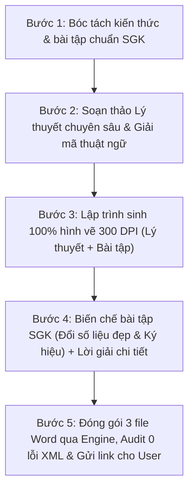

# MathPlus Chế Biến Lý Thuyết & Biến Chế Bài Tập Toán SGK (Lớp 10, 11, 12)

Skill chuyên dụng phục vụ công tác biên soạn học liệu độc quyền cho **Trung tâm MathPlus Academy** (Thầy Nguyễn Văn Dũng – Hotline: 0977 961 189 - 0982 899 669).

---

## 1. Mục Tiêu & Triết Lý Biên Soạn

Khi học sinh tiếp cận kiến thức Toán THPT (Lớp 10, 11, 12) theo sách giáo khoa mới (Kết nối tri thức với cuộc sống, Cánh diều, Chân trời sáng tạo), các em thường gặp 2 khó khăn lớn:
1. **Lý thuyết SGK cô đọng**: Nhiều công thức và ký hiệu trừu tượng nhưng thiếu giải thích trực quan, thiếu giải mã nguồn gốc thuật ngữ khiến học sinh học vẹt mà không hiểu bản chất sâu xa.
2. **Bài tập SGK bị chép giải tràn lan**: Học sinh dễ dàng tìm thấy lời giải mẫu hoặc đáp án trên mạng, làm triệt tiêu khả năng tự tư duy và luyện tập thực chất.

Skill `mathplus-che-bien-ly-thuyet-bai-tap` giải quyết triệt để 2 vấn đề trên theo phương pháp độc quyền của MathPlus:
* **Lý thuyết bài giảng chuyên sâu**: Giữ nguyên 100% công thức và ký hiệu chuẩn SGK, nhưng đi sâu vào bản chất hình học, ý nghĩa thực tiễn, giải mã nguồn gốc tiếng Anh/Latin, và luôn có 1 – 2 hình vẽ minh họa 300 DPI.
* **Bài tập biến chế từ SGK**: **Bám sát 100% cấu trúc, dạng bài và văn phong toán học của SGK**, nhưng được "biến chế" thông minh (đổi số liệu nghiệm đẹp, đổi tên điểm/ký hiệu hình học) để học sinh bắt buộc phải tự đặt bút làm bài, chống chép giải mẫu.
* **Hình vẽ minh họa toán học 300 DPI bắt buộc**: Cả **Phiếu đề bài** và **Bản lời giải chi tiết** đều bắt buộc phải có hình vẽ minh họa toán học sắc nét (`matplotlib`), giúp tài liệu trực quan, sinh động, chuẩn mực sư phạm.

---

## 2. Năm Nguyên Tắc Vàng Bất Biến (Core Commandments)

### Nguyên tắc 1: 100% Công thức & Ký hiệu Chuẩn Sách Giáo Khoa
* **Tuyệt đối không tự ý thay đổi ký hiệu của SGK**: Mọi ký hiệu chuẩn như $\vec{a}, \vec{0}, |\vec{a}|, (\vec{u}, \vec{v}), \vec{u} \cdot \vec{v}$, $M_e, M_o, Q_1, Q_2, Q_3$, $\lim_{x \to x_0} f(x) = L$ phải giữ nguyên vẹn.
* Các định nghĩa, định lí, tính chất cơ bản phải có khung viền màu cam (`add_sgk_box`) trích xuất đúng tinh thần chuẩn mực của SGK để học sinh dễ đối chiếu.

### Nguyên tắc 2: Bản Chất Học Thuật, Trực Quan & Giải Mã Thuật Ngữ
1. **Khởi đầu bằng bài toán tình huống thực tế hoặc lịch sử phát minh**: Mở đầu bài học bằng một vấn đề thực tế hoặc câu chuyện lịch sử khoa học (ví dụ: Tích vô hướng từ bài toán tính công cơ học, phát minh toạ độ của Descartes, thuyết tương đối Einstein...).
2. **Giải mã thuật ngữ & Nghĩa tiếng Anh (Etymology & Terminology)**: Sau mỗi phần lý thuyết lớn, bắt buộc có khung `add_callout` giải thích:
   * Từ viết tắt và nguồn gốc Latin/Anh (ví dụ: *Vector* – Người mang vác, *Dot Product*, *Orthogonal* – Trực giao, *Abscissa* – Hoành độ, *Ordinate* – Tung độ...).
   * Bản chất toán học đằng sau thuật ngữ đó.
3. **Hình vẽ minh họa trực quan độ nét cao (300 DPI)**: Cuối mỗi phần lý thuyết lớn, bắt buộc chèn 1 – 2 hình vẽ trực quan (`add_figure_box`) giải thích bản chất hình học.

### Nguyên tắc 3: Bắt Buộc Chèn Bài Tập & Lời Giải Xen Kẽ Ngay Sau Từng Mục Lý Thuyết (Interleaved Practice)
* **Bố cục sư phạm xen kẽ (Interleaved Layout)**: Tuyệt đối không gom toàn bộ lý thuyết thành một khối dài rồi mới để bài tập ở cuối bài. Sau mỗi mục lý thuyết lớn (khái niệm, định lí, tính chất), BẮT BUỘC chèn ngay 1 – 2 bài tập áp dụng biến chế từ SGK kèm khung lời giải chi tiết từng bước qua hàm `add_example_box`.
* **Học đến đâu – Vận dụng và xem lời giải mẫu ngay đến đó**: Giúp học sinh khắc sâu phương pháp chứng minh và tư duy hình học không gian ngay sau khi tiếp nhận định lí.
* **Nguồn bài tập biến chế**: Lấy trực tiếp từ các bài Luyện tập, Vận dụng, hoặc Bài tập SGK tương ứng với mục đó, chế biến nhẹ (đổi tên đỉnh, đổi số liệu nghiệm đẹp, đổi tỉ số) để học sinh chống chép giải nhưng vẫn bám sát 100% dạng bài SGK.

### Nguyên tắc 4: Nguyên Tắc "Biến Chế" Bài Tập Từ SGK (Chống Chép Giải)
* **Bám sát 100% câu chữ, văn phong và dạng toán của SGK**: Giữ nguyên tinh thần bài tập trong SGK (từ Luyện tập, Vận dụng đến Bài tập cuối bài).
* **TUYỆT ĐỐI KHÔNG tự bịa các ngữ cảnh công nghệ rườm rà**: Không tự ý chèn các bối cảnh vi mạch bán dẫn, mạng 5G, đài radar viễn thông... vào bài toán toán học thuần túy. Đề bài phải giữ trọn vẹn văn phong sư phạm trong sáng, gãy gọn, gần gũi của SGK.
* **Kỹ thuật biến chế cốt lõi**:
  1. **Đổi số liệu toán học**: Toạ độ điểm, hệ số vectơ, số đo góc, độ dài đoạn thẳng được tính toán cẩn thận để kết quả ra số nguyên hoặc phân số tối giản rất đẹp.
  2. **Đổi tên điểm & ký hiệu**: Với các bài toán chứng minh hình học phẳng và không gian, đổi luân phiên các đỉnh ($A, B, C, D \leftrightarrow M, N, P, Q$) để học sinh không thể tra cứu lời giải mạng mà phải tự tư duy vẽ hình và lập luận.
  3. **Lời giải chi tiết từng bước**: Trình bày mạch lạc, lập luận logic, nêu rõ căn cứ định lí/hệ thức áp dụng, có kết luận nghiệm rõ ràng.

### Nguyên tắc 5: Bắt Buộc Vẽ Hình Minh Họa 300 DPI Vào Cả Đề Bài Và Lời Giải
* **Tuyệt đối không để tài liệu hình học/vectơ/đồ thị trở thành văn bản chay thiếu hình vẽ**.
* **Trong Phiếu đề bài (`_De_Bai.docx`)**: Những câu hỏi có hình minh họa đề (lưới ô vuông, bàn cờ, sơ đồ chuyển động, các lực...) phải chèn hình vẽ ngay dưới câu hỏi qua hàm `add_question_figure`.
* **Trong Bản lời giải (`_Loi_Giai.docx`)**: BẮT BUỘC chèn hình vẽ minh họa từng bước giải toán trực tiếp bên trong khung lời giải (`IMAGE:<path>`, `CAPTION:<text>`).
* Toàn bộ hình vẽ được lập trình sinh tự động bằng `matplotlib`, xuất file PNG với độ phân giải cao **300 DPI**, lưu vào thư mục `images/` của từng bài học.

---

## 3. Quy Chuẩn Kỹ Thuật MathPlus Academy (Word DOCX)

Mọi file Word xuất ra phải tuân thủ nghiêm ngặt các quy chuẩn sau:
1. **Chữ đen tuyền – Nền trắng**: Toàn bộ chữ màu đen tuyệt đối (`RGBColor(0, 0, 0)` / `#000000`), nền trắng hoàn toàn.
2. **Cỡ chữ tối thiểu 11pt**: Toàn bộ nội dung văn bản dùng cỡ chữ $\ge 11\text{pt}$ (`Pt(11)` / `sz=22`), font **Times New Roman**.
3. **Không sọc đen viền trái**: Khung lời giải (`Solution Box`) nền trắng, bỏ hoàn toàn đường viền đen đậm bên trái (`left="none"`), chữ căn lề tự nhiên rõ ràng.
4. **Header nhận diện thương hiệu**:
   * Chèn **Logo MathPlus nguyên màu** (từ thư mục `resources/logo.jpg` hoặc `public/images/logo.jpg`) ở góc trái Header trang đầu.
   * Header ở các trang sau chỉ gồm Logo và tên: *Trung tâm MathPlus Academy* (chữ nghiêng 11pt, không viết hoa toàn bộ).
5. **Footer liên hệ giáo viên**: Đánh số trang tự động kèm thông tin:
   * *Thầy Nguyễn Văn Dũng – Hotline: 0977 961 189 - 0982 899 669*.
6. **100% OMML Math (Office Open XML Math)**:
   * Toàn bộ công thức toán học phải được biên dịch sang mã OMML gốc của Word bằng `latex_to_omml`.
   * **Tuyệt đối không để sót ký tự `$` thô trong XML** (luôn kiểm tra qua hàm `audit_docx`).
   * **Nguyên tắc công thức hiển thị (`DISPLAY:`)**: Thuần túy toán học, không nhét chữ tiếng Việt có dấu hoặc chú thích đơn vị vào thẻ `\text{...}` bên trong công thức đa dòng (tránh lỗi Cambria Math). Ghi chú đơn vị đưa xuống dòng văn bản bên dưới.
7. **Bảng thông tin học sinh (`show_student_info`)**:
   * **CHỈ HIỂN THỊ** trong file Đề bài (`_De_Bai.docx`) để học sinh điền họ tên, lớp, ngày làm bài, điểm số.
   * **TUYỆT ĐỐI KHÔNG HIỂN THỊ** trong file Lý thuyết (`_Ly_Thuyet_*.docx`) và file Lời giải (`_Loi_Giai.docx`).
8. **TUYỆT ĐỐI KHÔNG XUẤT FILE PDF**: Chỉ xuất duy nhất file Word (`.docx`) theo yêu cầu chính thức của Thầy Dũng.

---

## 4. Cấu Trúc Thư Mục Chuẩn Hóa Của Khóa Học

Toàn bộ tài liệu được phân cấp khoa học và nhất quán theo cấu trúc:
```text
Toan[Lớp]/
└── SGK_TAP_[Tập]/
    └── [TÊN_CHƯƠNG]/
        ├── [TÊN_BÀI_1]/
        │   ├── images/
        │   │   ├── fig1_theory_....png
        │   │   ├── fig2_theory_....png
        │   │   ├── ex_1_problem_....png
        │   │   └── ex_2_solution_....png
        │   ├── SGK[Lớp]_KNTT_T[Tập]_Ly_Thuyet_Chi_Tiet_Chuong_[C]_Bai_[B]_[Tên_Bài].docx
        │   ├── SGK[Lớp]_KNTT_T[Tập]_Bai_[B]_[Tên_Bài]_De_Bai.docx
        │   └── SGK[Lớp]_KNTT_T[Tập]_Bai_[B]_[Tên_Bài]_Loi_Giai.docx
        ├── [TÊN_BÀI_2]/
        │   └── ...
```

*Ví dụ thực tế cho Toán 10 Tập 1 Chương 4*:
```text
Toan10/SGK_TAP_1/CHUONG_04_VECTO/
├── BAI_07_CAC_KHAI_NIEM_MO_DAU/
├── BAI_08_TONG_VA_HIEU_CUA_HAI_VECTO/
├── BAI_09_TICH_CUA_MOT_VECTO_VOI_MOT_SO/
├── BAI_10_VECTO_TRONG_MAT_PHANG_TOA_DO/
└── BAI_11_TICH_VO_HUONG_CUA_HAI_VECTO/
```

---

## 5. Quy Trình 5 Bước Thực Hiện Của Agent



### Bước 1: Tiếp nhận & Bóc tách kiến thức SGK
- Xác định rõ Lớp, Tập, Chương, Bài theo bộ sách (KNTT, Cánh diều, Chân trời).
- Bóc tách toàn bộ: Khung định nghĩa, định lý, công thức trọng tâm, Luyện tập, Vận dụng và toàn bộ Bài tập cuối bài.

### Bước 2: Biên soạn Lý thuyết chuyên sâu & Bản chất sư phạm
- Mở đầu bằng bài toán tình huống thực tế hoặc lịch sử phát minh.
- Trình bày từng phần lý thuyết với khung chuẩn SGK viền cam (`add_sgk_box`).
- Chèn khung `add_callout` giải mã từ vựng, từ viết tắt, tiếng Anh/Latin.
- Xây dựng ví dụ minh họa kèm lời giải chi tiết từng bước (`add_example_box`).

### Bước 3: Lập trình sinh toàn bộ hình vẽ 300 DPI (`matplotlib`)
- Viết script Python sinh đầy đủ 2 nhóm hình vẽ:
  1. **Hình vẽ lý thuyết** (`fig1_...`, `fig2_...`): Mô hình hóa bản chất khái niệm.
  2. **Hình vẽ bài tập** (`ex_...`): Lưới ô vuông, bàn cờ, sơ đồ chuyển động, hợp lực, tam giác, hình bình hành, toạ độ điểm...
- Yêu cầu kỹ thuật: `dpi=300`, nền trắng, nét vẽ đậm rõ nét (`lw=1.5` – `2.5`), màu sắc tương phản cao (Navy `#1e3a8a`, Xanh `#0284c7`, Đỏ `#dc2626`, Nét đứt `#94a3b8`), nhãn chữ to rõ không bị đè chữ. Lưu vào thư mục `images/` của bài học.

### Bước 4: Biến chế hệ thống bài tập & Soạn lời giải chi tiết
- Giữ nguyên 100% cấu trúc dạng bài và câu chữ SGK.
- Đổi số liệu để ra nghiệm nguyên hoặc phân số rất đẹp.
- Đổi tên đỉnh hình học ($A, B, C, D \leftrightarrow M, N, P, Q$) với bài toán chứng minh.
- Soạn lời giải chi tiết, rõ ràng từng bước, tích hợp cú pháp hình ảnh:
  ```python
  'IMAGE:' + os.path.join(img_dir, 'ex_....png'),
  'CAPTION:Hình ...: Minh hoạ lời giải chi tiết...'
  ```

### Bước 5: Đóng gói tài liệu Word & Audit XML
- Khởi tạo `MathPlusDocxBuilder` từ `scripts/mathplus_docx_engine.py`:
  - `b_theory`: `show_student_info=False`, `is_solved=True`.
  - `b_blank`: `show_student_info=True`, `is_solved=False`, duyệt `problems_data` chèn header và `add_question_figure` nếu có.
  - `b_solved`: `show_student_info=False`, `is_solved=True`, duyệt `problems_data` chèn header, `add_question_figure` (nếu có đề) và `add_solution` (chứa các bước giải và ảnh giải toán).
- Chạy hàm `audit_docx(path)` xác nhận:
  - **0 ký tự `$` thô** trong XML.
  - **0 thẻ LaTeX lỗi** trong văn bản.
- Gửi báo cáo kèm các đường link clickable dạng `file:///` cho người dùng.

---

## 6. Case Study Điển Hình Đã Triển Khai Hoàn Hảo

### Toán 10 Tập 1 – Chương IV: Vectơ (Bộ Kết nối tri thức với cuộc sống)
* **Thư mục lưu trữ**: `c:\code\mathplus\Toan10\SGK_TAP_1\CHUONG_04_VECTO\`
* **Quy mô hoàn thành**:
  - **5 bài học**: Bài 7 (Các khái niệm mở đầu), Bài 8 (Tổng & hiệu vectơ), Bài 9 (Tích vectơ với số), Bài 10 (Vectơ toạ độ), Bài 11 (Tích vô hướng).
  - **15 file Word (.docx)** chuẩn nhận diện MathPlus, 100% OMML.
  - **31 hình vẽ 300 DPI**: 10 hình vẽ lý thuyết + 21 hình vẽ minh họa chi tiết từng bài tập (từ Bài 4.1 đến Bài 4.26).
  - Đề bài bám sát 100% SGK, loại bỏ hoàn toàn các lời dẫn công nghệ rườm rà, số liệu đổi mới ra nghiệm nguyên đẹp, chống chép giải 100%.
