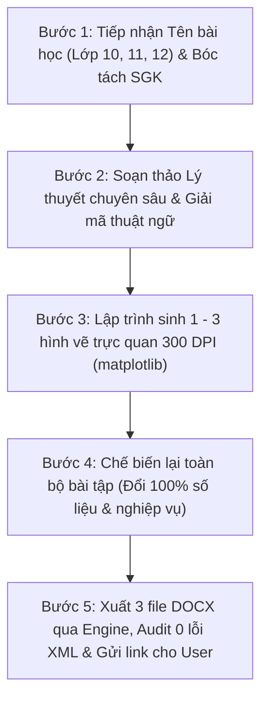

# MathPlus Chế Biến Lý Thuyết & Bài Tập Toán 10, 11, 12

Skill chuyên dụng phục vụ công tác biên soạn học liệu độc quyền cho **Trung tâm MathPlus Academy** (Thầy Nguyễn Văn Dũng – Hotline: 0977 961 189).

---

## 1. Mục tiêu & Triết lý Biên Soạn

Khi học sinh tiếp cận kiến thức Toán THPT (Lớp 10, 11, 12) theo sách giáo khoa mới (Kết nối tri thức, Cánh diều, Chân trời sáng tạo), các em thường gặp 2 khó khăn lớn:
1. Sách giáo khoa viết cô đọng, nhiều công thức và ký hiệu trừu tượng nhưng thiếu giải thích trực quan, thiếu giải mã nguồn gốc thuật ngữ khiến học sinh học vẹt.
2. Bài tập trong sách giáo khoa nhanh chóng bị học sinh tìm thấy sách giải mẫu hoặc đáp án trên mạng, làm giảm động lực tự tư duy.

Skill `mathplus-che-bien-ly-thuyet-bai-tap` giải quyết triệt để 2 vấn đề trên:
* **Lý thuyết bài giảng được "biến chế" chuyên sâu**: Giữ nguyên 100% công thức và ký hiệu chuẩn SGK, nhưng đi sâu vào bản chất hình học, ý nghĩa thực tiễn, giải mã nguồn gốc tiếng Anh/Latin, và luôn có hình vẽ minh họa 300 DPI.
* **Bài tập được "chế biến lại" hoàn toàn**: Bám sát dạng toán và mức độ tư duy của SGK, nhưng **100% đổi mới số liệu và chuyển đổi nghiệp vụ** sang các bối cảnh hiện đại (CNTT, điện toán đám mây, vi mạch bán dẫn, lưới điện thông minh, kinh tế quy mô, robot tự hành, logistics...).

---

## 2. Ba Nguyên Tắc Bất Biến (Core Commandments)

### Nguyên tắc 1: 100% Công thức & Ký hiệu Đồng bộ Sách Giáo Khoa
* **Tuyệt đối không tự ý thay đổi ký hiệu của SGK**: Mọi ký hiệu chuẩn như $M_e, M_o, Q_1, Q_2, Q_3, \Delta_Q$, $\lim_{x \to x_0} f(x) = L$, $x \to x_0^+$, $x \to \pm\infty$ phải giữ nguyên vẹn.
* Các định nghĩa, định lí, tính chất cơ bản phải có khung đóng màu cam (`add_sgk_box`) trích xuất đúng tinh thần chuẩn mực của SGK để học sinh dễ đối chiếu.

### Nguyên tắc 2: Bản chất Học thuật, Trực quan & Giải mã Thuật ngữ
1. **Khởi đầu bằng bài toán tình huống thực tế hoặc lịch sử phát minh**: Mở đầu bài học bằng một vấn đề thực tế hoặc câu chuyện lịch sử khoa học (ví dụ: Thuyết tương đối Einstein với giới hạn vận tốc ánh sáng, bài toán phân nhóm thu nhập thực tế...).
2. **Giải mã thuật ngữ & Nghĩa tiếng Anh (Etymology & Terminology)**: Sau mỗi phần lý thuyết lớn, bắt buộc có khung `add_callout` giải thích:
   * Từ viết tắt và nguồn gốc Latin/Anh (ví dụ: $\lim$ – *Limit*, $M_e$ – *Median*, $M_o$ – *Mode*, $Q$ – *Quartile*, Asymptote, Indeterminate form, Conjugate...).
   * Bản chất toán học đằng sau thuật ngữ đó.
3. **Hình vẽ minh họa trực quan độ nét cao (300 DPI)**: Cuối mỗi phần lý thuyết lớn, bắt buộc chèn 1 – 2 hình vẽ trực quan (`add_figure_box`) giải thích bản chất hình học (ví dụ: tiếp cận hai phía & điểm khuyết, bước nhảy gián đoạn Heaviside, tiệm cận đứng và tiệm cận ngang, đường tròn lượng giác...).

### Nguyên tắc 3: 100% Đổi mới Số liệu & Nghiệp vụ Thực tế (Không chép SGK)
* Toàn bộ các ví dụ minh họa trong bài lý thuyết và toàn bộ bài tập tự luyện trong bài giải **tuyệt đối không sao chép nguyên văn số liệu từ SGK**.
* **Đổi số liệu**: Thay đổi các hệ số, nghiệm, tham số sao cho số liệu đẹp, vừa vặn, chuẩn mực sư phạm.
* **Đổi nghiệp vụ**: Thay các bối cảnh học sinh/chung chung bằng các bài toán kỹ thuật, kinh tế, đời sống hiện đại:
  * Khảo sát lưu lượng băng thông máy chủ đám mây (Cloud Server bandwidth).
  * Hao phí năng lượng cổng logic vi mạch tự động (Semiconductor energy loss).
  * Đóng ngắt rơ-le tiếp điểm lưới điện thông minh (Smart Grid relay switching).
  * Biểu phí thu cước dữ liệu di động vượt định mức (Mobile tiered data fee).
  * Tối ưu chi phí sản xuất linh kiện theo quy mô (Economies of scale).
  * Khoảng cách hội tụ quỹ đạo hai robot tự hành (Autonomous robot distance).
  * Áp suất buồng nén pít-tông khí nén thủy lực (Hydraulic pressure cylinder).

---

## 3. Quy Chuẩn Kỹ Thuật MathPlus Academy (Word DOCX)

Mọi file Word xuất ra phải tuân thủ nghiêm ngặt các quy chuẩn sau:
1. **Chữ đen tuyền – Nền trắng**: Toàn bộ chữ màu đen tuyệt đối (`RGBColor(0, 0, 0)` / `#000000`), nền trắng hoàn toàn.
2. **Cỡ chữ tối thiểu 11pt**: Toàn bộ nội dung văn bản dùng cỡ chữ $\ge 11\text{pt}$ (`Pt(11)` / `sz=22`), font **Times New Roman**.
3. **Không sọc đen viền trái**: Khung lời giải (`Solution Box`) nền trắng, bỏ hoàn toàn đường viền đen đậm bên trái (`w:left`), chữ căn lề tự nhiên rõ ràng.
4. **Header nhận diện thương hiệu**:
   * Chèn **Logo MathPlus nguyên màu** (từ thư mục `resources/logo.jpg`) ở góc trái Header trang đầu.
   * Header ở các trang sau chỉ gồm Logo và tên: *Trung tâm MathPlus Academy* (chữ nghiêng 11pt, không viết hoa toàn bộ).
5. **Footer liên hệ giáo viên**: Đánh số trang tự động kèm thông tin:
   * *Thầy Nguyễn Văn Dũng – Hotline: 0977 961 189 - 0982 899 669*.
6. **100% OMML Math (Office Open XML Math)**:
   * Toàn bộ công thức toán học phải được biên dịch sang mã OMML gốc của Word bằng `latex_to_omml`.
   * **Tuyệt đối không để sót ký tự `$` thô trong XML** (luôn kiểm tra qua hàm `audit_docx`).
   * **Nguyên tắc vàng công thức hiển thị (`DISPLAY:`)**: Không nhét chữ tiếng Việt có dấu hoặc chú thích đơn vị vào thẻ `\text{...}` bên trong công thức đa dòng (để tránh lỗi phông chữ Cambria Math). Công thức hiển thị phải thuần túy toán học, các ghi chú đơn vị và điều kiện đưa xuống đoạn văn bên dưới.
7. **TUYỆT ĐỐI KHÔNG XUẤT FILE PDF**: Chỉ xuất duy nhất file Word (`.docx`) theo yêu cầu chính thức của Thầy Dũng.

---

## 4. Bộ Tài Liệu Đầu Ra Chuẩn Của Mỗi Bài Học

Mỗi bài học được xử lý sẽ xuất ra **3 file Word chuẩn**:
1. **File Cẩm nang Lý thuyết chuyên sâu & Bản chất học thuật**:
   * Tên file: `SGK[Lớp]_KNTT_T[Tập]_Ly_Thuyet_Chi_Tiet_Chuong_[C]_Bai_[B]_[Ten_Bai].docx`
   * Lưu tại: `C:\code\mathplus\Toan[Lớp]\lythuyet\` và bản sao tại thư mục chương tương ứng.
   * Chứa toàn bộ lý thuyết SGK, giải mã tiếng Anh, hình vẽ 300 DPI và các ví dụ nghiệp vụ mới.
2. **File Lời giải Toàn bộ Bài tập SGK Đã Chế Biến Lại**:
   * Tên file: `SGK[Lớp]_KNTT_T[Tập]_Bai_[B]_[Ten_Bai]_Loi_Giai.docx`
   * Lưu tại: `C:\code\mathplus\Toan[Lớp]\SGK_TAP_[Tập]_LOI_GIAI\CHƯƠNG_[C]\`
   * Chứa toàn bộ bài tập (Luyện tập, Vận dụng, Bài tập cuối bài) với số liệu mới 100% và lời giải chi tiết.
3. **File Phiếu Đề bài Tự luyện cho Học sinh**:
   * Tên file: `SGK[Lớp]_KNTT_T[Tập]_Bai_[B]_[Ten_Bai]_De_Bai.docx`
   * Lưu cùng thư mục với file lời giải, có khung điền họ tên học sinh, lớp, điểm số.

---

## 5. Quy Trình 5 Bước Thực Hiện Của Agent



### Bước 1: Tiếp nhận & Bóc tách kiến thức SGK
- Xác định rõ Lớp (10, 11, 12), Bộ sách (Kết nối tri thức, Cánh diều, Chân trời), Chương và Bài.
- Bóc tách toàn bộ:
  - Khung định nghĩa, định lí, công thức trọng tâm.
  - Các mục Luyện tập (1, 2, 3...) và Vận dụng.
  - Các bài tập cuối bài (tự luận, trắc nghiệm).

### Bước 2: Biên soạn Lý thuyết chuyên sâu & Giải mã tiếng Anh
- Viết lời mở đầu khơi gợi hứng thú học tập.
- Trình bày từng phần lớn (Phần I, II, III...) với khung chuẩn SGK viền cam (`add_sgk_box`).
- Chèn khung `add_callout` giải mã từ vựng, từ viết tắt, tiếng Anh/Latin.
- Xây dựng các ví dụ minh họa dạng SGK nhưng đổi 100% số liệu và nghiệp vụ (`add_example_box`).

### Bước 3: Lập trình sinh hình vẽ trực quan 300 DPI
- Viết script Python sử dụng `matplotlib`:
  - Độ phân giải: 300 DPI.
  - Bảng màu hài hòa, tương phản cao (Navy `#003366`, Xanh lam `#0284C7`, Đỏ `#DC2626`).
  - Font chữ rõ ràng, không bị đè chữ, có nhãn chú thích toán học.
- Lưu hình ảnh vào thư mục `images/` cạnh file văn bản.

### Bước 4: Chế biến lại hệ thống bài tập
- Lập bảng thiết kế số liệu mới cho từng bài tập SGK:
  - Giữ nguyên cấu trúc logic giải toán của SGK.
  - Thay số liệu mới hoàn toàn (nghiệm đẹp, số nguyên hoặc phân số gọn).
  - Thay đổi bối cảnh thực tế sang các ngành công nghệ, kỹ thuật, kinh tế hiện đại.
- Soạn lời giải chi tiết từng bước:
  - Nhận diện dạng toán.
  - Phân tích nhân tử / Khử vô định / Lập luận từng bước.
  - Kết luận và nhận xét ý nghĩa thực tế.

### Bước 5: Đóng gói tài liệu Word & Audit XML
- Chạy script Python sử dụng `MathPlusDocxBuilder` từ `scripts/mathplus_docx_engine.py`.
- Tạo đồng thời 3 file: Lý thuyết, Lời giải bài tập, Phiếu đề bài học sinh.
- Thực hiện hàm `audit_docx(path)`:
  - Đảm bảo **0 ký tự `$` thô** trong toàn bộ các file `word/document.xml`.
  - Đảm bảo **0 tag LaTeX lỗi** (`DISPLAY:`, `\frac`, `\quad`) xuất hiện dưới dạng chuỗi text.
- Tuyệt đối **không gọi lệnh xuất PDF**.
- Cung cấp clickable link định dạng `file:///` đến các file Word hoàn thiện cho người dùng.

---

## 6. Cấu Trúc Thư Mục Skill

```
mathplus-che-bien-ly-thuyet-bai-tap/
├── SKILL.md                          # Tài liệu hướng dẫn chuẩn cho Agent
├── resources/
│   └── logo.jpg                      # Logo MathPlus Academy nguyên màu
└── scripts/
    ├── omml_converter.py             # Bộ chuyển đổi LaTeX sang OMML Word Native
    ├── mathplus_docx_engine.py       # Engine dựng Word chuẩn MathPlus & Audit XML
    ├── generate_figures_helper.py    # Thư viện hàm vẽ hình toán học 300 DPI
    ├── build_theory_template.py      # Template script sinh file Lý thuyết
    └── build_exercise_template.py    # Template script sinh file Bài tập & Đề bài
```

---

## 7. Các Bài Mẫu Đã Triển Khai Thành Công (Reference Case Studies)

1. **Toán 11 – Chương III: Các số đặc trưng đo xu thế trung tâm của mẫu số liệu ghép nhóm**:
   * *Bài 9*: Trung bình, Trung vị ($M_e$ – Median), Tứ phân vị ($Q_1, Q_2, Q_3$), Mốt ($M_o$ – Mode).
   * File lý thuyết kèm hình vẽ biểu đồ tần số tích lũy & phân vị.
   * File lời giải đổi số liệu toàn bộ bài tập sang quản lý năng suất lao động nhà máy, khảo sát tiền lương nhân viên.
2. **Toán 11 – Chương V: Giới hạn. Hàm số liên tục**:
   * *Bài 16: Giới hạn của hàm số*: Giới hạn tại điểm, giới hạn một bên, giới hạn tại vô cực, giới hạn vô cực.
   * 3 hình vẽ trực quan 300 DPI: Điểm khuyết & tiếp cận hai phía, bước nhảy gián đoạn Heaviside, tiệm cận đứng & tiệm cận ngang.
   * Ví dụ và bài tập đổi số liệu 100% sang đo kiểm băng thông đám mây, vi mạch bán dẫn, rơ-le Smart Grid, chi phí quy mô sản xuất.
