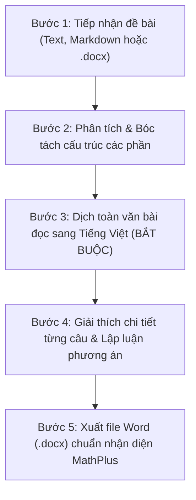

# MathPlus Giải Tiếng Anh: Bộ Công Cụ Giải Đề, Dịch Bài Đọc & Biên Soạn Lời Giải Tiếng Anh Chuẩn Sư Phạm

## 1. Tổng quan
Skill `mathplus-giai-tieng-anh` cung cấp năng lực giải đề, dịch thuật và biên soạn tài liệu giảng dạy Tiếng Anh toàn diện cho giáo viên và học sinh **MathPlus Academy**:
- **Đầu vào linh hoạt**: Tiếp nhận đề thi dưới dạng text thô, markdown hoặc file Word (`.docx`) thuộc mọi dạng bài: Ngữ âm (Pronunciation / Stress), Từ vựng & Ngữ pháp (Grammar & Vocabulary), Đọc hiểu (Reading Comprehension), Điền từ (Cloze Test), Tìm lỗi sai (Error Identification), Viết lại câu (Sentence Transformation), Giao tiếp (Conversational Exchanges).
- **Giải thích chi tiết từng câu**: Không chỉ đưa ra chữ cái đáp án đơn thuần, mà bắt buộc phân tích:
  - Dịch nghĩa câu hỏi và các phương án lựa chọn sang tiếng Việt.
  - Chỉ rõ cấu trúc ngữ pháp, collocations, idioms hoặc quy tắc phát âm/trọng âm tương ứng.
  - Phân tích chi tiết lý do chọn đáp án đúng và lý do loại trừ các phương án gây nhiễu.
  - Trích dẫn dẫn chứng trực tiếp từ bài đọc (nếu là câu hỏi đọc hiểu).
- **BẮT BUỘC Dịch Toàn Văn Bài Đọc Sang Tiếng Việt**: Đối với mọi đoạn văn đọc hiểu (Reading Comprehension) hoặc bài đọc điền từ (Cloze Test), hệ thống **bắt buộc** cung cấp bản dịch tiếng Việt hoàn chỉnh, trau chuốt, tự nhiên, sát nghĩa và chuẩn phong cách sư phạm, giúp học sinh nắm vững ngữ cảnh và từ vựng.
- **Bảng Tra Cứu Toàn Diện**:
  - Bảng đáp án nhanh (**Quick Answer Key**) dạng lưới 10 câu/hàng tiện tra cứu đối chiếu.
  - Bảng tổng hợp từ vựng & cấu trúc trọng tâm (**Key Vocabulary & Structures**) gồm: Từ vựng, phiên âm quốc tế IPA, loại từ, nghĩa tiếng Việt và ví dụ minh họa.
- **Định dạng Word chuyên nghiệp chuẩn Nhận diện MathPlus**:
  - **Cỡ chữ toàn văn bản tối thiểu 11pt** (`Pt(11)` / `sz=22`): Không dùng cỡ chữ nhỏ hơn 11pt ở bất kỳ thành phần nào (kể cả Header, Footer, chú thích, bảng biểu).
  - **Chữ màu Đen tuyền tuyệt đối** (`RGBColor(0, 0, 0)` / `#000000`), **nền trắng hoàn toàn** (`#FFFFFF`), không tô nền màu hay dùng chữ màu khác.
  - **Khung lời giải chi tiết (Solution Box)**: Nền trắng, **bỏ hoàn toàn sọc đen bên trái** (không dùng viền trái `w:left`), chữ căn lề tự nhiên rõ ràng, dễ nhìn.
  - **Chèn Logo MathPlus ở Header**: Logo giữ nguyên màu thương hiệu gốc (lấy từ `C:\code\mathplus\public\images\logo.jpg` hoặc `resources/logo.jpg`), đặt tại góc trái Header đầu trang.
  - **Header ở các trang sau**: Chỉ gồm **Logo MathPlus** và tên **Trung tâm MathPlus Academy** (chữ nghiêng 11pt, không viết hoa toàn bộ), bỏ hoàn toàn phần text tiêu đề đề thi phía sau.
  - Header & Footer trang nhã, đánh số trang tự động kèm Hotline `0977 961 189` và chữ ký giáo viên `Nguyễn Văn Dũng`.
  - Hỗ trợ ký hiệu gạch chân `<u>...</u>` chuẩn xác cho các bài kiểm tra phát âm, trọng âm và gạch chân lỗi sai.

---

## 2. Quy trình Thực Hiện 5 Bước của Agent

Khi người dùng yêu cầu giải đề thi Tiếng Anh hoặc chuyển nội dung đề bài sang file Word có lời giải:



### Bước 1: Tiếp nhận & Chuẩn hóa đề bài
- Đọc nội dung đề thi từ text người dùng cung cấp hoặc trích xuất từ file `.docx`.
- Nhận diện các dạng bài:
  - Dạng 1: Ngữ âm (Pronunciation & Stress) - xác định phần gạch chân `<u>...</u>`.
  - Dạng 2: Ngữ pháp & Từ vựng (Multiple-choice Lexico-Grammar).
  - Dạng 3: Điền từ vào đoạn văn (Cloze Test / Guided Cloze).
  - Dạng 4: Đọc hiểu văn bản (Reading Comprehension).
  - Dạng 5: Tìm lỗi sai (Error Identification).
  - Dạng 6: Viết lại câu / Kết hợp câu (Sentence Transformation / Sentence Combining).

### Bước 2: Dịch toàn văn bài đọc sang Tiếng Việt (BẮT BUỘC)
- Với **tất cả** bài đọc hiểu (Reading Passage) và bài đọc điền từ (Cloze Test):
  - Phải dịch toàn bộ bài đọc sang Tiếng Việt một cách trôi chảy, trau chuốt, chuẩn văn phong học thuật.
  - Giữ nguyên cấu trúc đánh số đoạn văn `[1]`, `[2]`, `[3]` để học sinh dễ đối chiếu với bản gốc tiếng Anh.
  - Đặt bản dịch ngay sau đoạn văn đề bài hoặc trong khung dịch nghĩa riêng biệt (`add_reading_translation`).

### Bước 3: Giải chi tiết từng câu
Mỗi câu hỏi trong phần lời giải **bắt buộc** phải tuân theo cấu trúc chuẩn:
1. **Đáp án đúng**: Chỉ rõ chữ cái được chọn (ví dụ: `Đáp án đúng: C`).
2. **Dịch nghĩa câu hỏi & phương án**:
   - Dịch nghĩa câu hỏi / câu chứa chỗ trống.
   - Dịch nghĩa toàn bộ 4 phương án A, B, C, D (kèm phiên âm IPA nếu là câu ngữ âm).
3. **Cấu trúc / Quy tắc cần nhớ**:
   - Nêu rõ công thức ngữ pháp (ví dụ: `If + S + V2/V-ed, S + would + V-bare`), cấu trúc cụm động từ (phrasal verb), cụm cố định (collocation) hoặc quy tắc phát âm đuôi `-ed`, `-s/-es`.
4. **Giải thích chi tiết (Lý do chọn)**:
   - Phân tích ngữ cảnh, dấu hiệu nhận biết thì, sự hòa hợp chủ - vị, liên từ hoặc từ loại.
5. **Dẫn chứng trong bài đọc (đối với câu hỏi Đọc hiểu)**:
   - Trích dẫn trực tiếp câu văn trong bài đọc làm căn cứ suy luận (ví dụ: *Dẫn chứng: "spending at least 25 minutes a day with a good book can remarkably reduce stress..." (Đoạn 2, dòng 3-4)*).
6. **Phân tích loại trừ phương án gây nhiễu**:
   - Chỉ rõ vì sao các phương án còn lại là sai (sai ngữ pháp, sai nghĩa, không có thông tin hoặc mâu thuẫn với bài đọc).

### Bước 4: Tổng hợp Bảng Đáp án nhanh & Bảng Từ vựng
- Lập bảng **Quick Answer Key** (lưới các câu 1-10, 11-20...) đặt ở cuối hoặc đầu phần lời giải để học sinh tiện tra nhanh.
- Lập bảng **Key Vocabulary & Structures** tổng hợp các từ mới xuất hiện trong đề:
  - Cột: STT | Từ vựng / Cụm từ | Phiên âm (IPA) | Loại từ | Nghĩa Tiếng Việt & Ví dụ minh họa.

### Bước 5: Đóng gói tài liệu Word qua Engine MathPlus
- Gọi `MathPlusDocxBuilder` từ script `C:\Users\nguye\.gemini\config\skills\mathplus-giai-tieng-anh\scripts\mathplus_docx_engine.py`:
  - Khởi tạo tài liệu với tiêu đề đề thi, năm học, thời gian làm bài.
  - Sử dụng các phương thức chuyên dụng: `add_section`, `add_instruction`, `add_reading_passage`, `add_reading_translation`, `add_question`, `add_solution_box`, `add_quick_answer_key`, `add_vocabulary_table`.
  - Thêm phần tự đánh giá (`add_self_evaluation`) và nhận xét của giáo viên (`add_teacher_feedback_and_signature`).
  - Xuất thành 2 file:
    1. Bản đề bài học sinh: `[Tên_Đề].docx`
    2. Bản có giải chi tiết & dịch nghĩa: `[Tên_Đề]_Solved.docx`

---

## 3. Cấu Trúc Mã Nguồn Module Skill

Thư mục skill đặt tại `C:\Users\nguye\.gemini\config\skills\mathplus-giai-tieng-anh\`:
```
mathplus-giai-tieng-anh/
├── SKILL.md                          # Tài liệu hướng dẫn vận hành cho Agent
├── resources/
│   └── logo.jpg                      # Logo MathPlus Academy (giữ nguyên màu gốc khi chèn Header)
├── scripts/
│   ├── mathplus_docx_engine.py       # Engine dựng tài liệu Word Tiếng Anh chuẩn OpenXML & MathPlus
│   ├── omml_converter.py             # Bộ chuyển đổi ký hiệu toán học / công thức nếu cần
│   └── cli.py                        # Script CLI điều phối biên soạn đề thi từ dòng lệnh
└── examples/
    ├── generate_sample.py            # Script mẫu tạo đề thi hoàn chỉnh
    └── De_Thi_Tieng_Anh_Lop_10_Solved.docx # File Word mẫu đã giải & dịch nghĩa hoàn chỉnh
```

### Hướng Dẫn Sử Dụng Engine trong Python Script:

```python
import sys
sys.path.append(r"C:\Users\nguye\.gemini\config\skills\mathplus-giai-tieng-anh\scripts")

from mathplus_docx_engine import MathPlusDocxBuilder

# 1. Khởi tạo tài liệu chuẩn MathPlus
builder = MathPlusDocxBuilder(
    title="ĐỀ THI TUYỂN SINH VÀO LỚP 10 MÔN TIẾNG ANH",
    subtitle="Năm học 2026 – 2027",
    time_limit="60 phút",
    subject_center="Bồi dưỡng Tiếng Anh & Luyện thi",
    is_solved=True,
    logo_path=r"C:\code\mathplus\public\images\logo.jpg"
)

# 2. Thêm Phần & Câu lệnh hướng dẫn
builder.add_section("PHẦN I. NGỮ ÂM (PHONETICS)")
builder.add_instruction("Mark the letter A, B, C, or D on your answer sheet to indicate the word whose underlined part differs...")

# 3. Thêm câu hỏi phát âm (sử dụng <u>...</u> để gạch chân)
builder.add_question("Question 1:", "", options={'A': 'arr<u>i</u>ve', 'B': 'l<u>i</u>ke', 'C': 'c<u>i</u>ty', 'D': 'n<u>i</u>ce'})

# 4. Thêm lời giải chi tiết (không sọc đen viền trái, font >= 11pt)
builder.add_solution_box(
    key="C",
    explanation="Phương án C có chữ 'i' phát âm là /ɪ/, các phương án còn lại phát âm là /aɪ/.",
    options_meaning="A. arrive /əˈraɪv/ | B. like /laɪk/ | C. city /ˈsɪti/ | D. nice /naɪs/",
    grammar="Quy tắc phát âm của nguyên âm 'i'."
)

# 5. Thêm bài đọc hiểu & BẢN DỊCH TIẾNG VIỆT TOÀN VĂN
builder.add_section("PHẦN II. ĐỌC HIỂU (READING COMPREHENSION)")
builder.add_reading_passage(passage_text, title="THE POWER OF READING")
builder.add_reading_translation(translation_text, title="BẢN DỊCH TIẾNG VIỆT TOÀN VĂN BÀI ĐỌC")

# 6. Thêm bảng đáp án nhanh & bảng từ vựng
builder.add_quick_answer_key({'Question 1': 'C', 'Question 2': 'B'})
builder.add_vocabulary_table([
    ('acquire', '/əˈkwaɪər/', 'v', 'tiếp thu, thu nhận được', 'acquire knowledge'),
    ('critical thinking', '/ˌkrɪt.ɪ.kəl ˈθɪŋ.kɪŋ/', 'n', 'tư duy phản biện', 'develop critical thinking')
])

# 7. Thêm phần tự đánh giá & nhận xét của giáo viên
builder.add_self_evaluation(["Nhận biết quy tắc phát âm nguyên âm", "Kỹ năng tìm ý chính bài đọc"])
builder.add_teacher_feedback_and_signature(teacher_name="Nguyễn Văn Dũng – MathPlus Academy")

# 8. Lưu file Word
builder.save(r"C:\code\mathplus\tienganh\De_Thi_Solved.docx")
```

---

## 4. Các Tiêu Chuẩn Bắt Buộc (Rules & Checklist)

1. **Màu sắc & Định dạng thương hiệu**:
   - **Cỡ chữ tối thiểu 11pt**: Toàn bộ văn bản, câu hỏi, phương án, lời giải, bảng biểu, đầu trang và chân trang có cỡ chữ tối thiểu 11pt (`Pt(11)` / `sz=22`).
   - **Chữ màu Đen tuyền 100%** (`RGBColor(0, 0, 0)`): Tuyệt đối không dùng chữ màu xanh, đỏ hay xám nhạt.
   - **Nền Trắng 100%**: Không tô nền màu (Shading) cho bảng, ô hay khung lời giải.
   - **Bỏ hoàn toàn sọc đen bên trái khung lời giải**: Lời giải được đóng khung thoáng đãng, dễ nhìn, không có đường viền đen đậm bên trái (`left="none"`).
   - **Logo MathPlus nguyên màu thương hiệu**: Đặt ở góc trái Header đầu trang.
   - **Header các trang sau**: Chỉ gồm Logo MathPlus và tên `Trung tâm MathPlus Academy` (11pt nghiêng, không viết hoa toàn bộ), bỏ hoàn toàn phần text tiêu đề đề thi phía sau.
2. **Quy chuẩn chất lượng Lời Giải Tiếng Anh**:
   - **BẮT BUỘC Dịch toàn văn bài đọc sang tiếng Việt**: Tuyệt đối không bỏ qua bước này. Bất kể bài đọc ngắn hay dài, phải dịch trọn vẹn, không cắt xén, giữ nguyên cấu trúc đoạn để học sinh dễ đối chiếu.
   - **BẮT BUỘC Giải thích chi tiết cho từng câu**: Nêu rõ lý do chọn, công thức ngữ pháp, dịch nghĩa câu hỏi, dịch các phương án và trích dẫn bằng chứng từ bài đọc.
   - **Hỗ trợ gạch chân chuẩn xác (`<u>...</u>`)**: Dùng cho bài phát âm, trọng âm và 4 vị trí gạch chân A, B, C, D trong bài tìm lỗi sai.
3. **Tuân thủ chuẩn ECMA-376 OpenXML**:
   - Đảm bảo 100% file Word xuất ra mở mượt mà trên Microsoft Word, WPS Office, LibreOffice mà không có bất kỳ thông báo lỗi file hay cảnh báo sửa chữa file nào.
4. **Nhận diện giáo viên & Trung tâm MathPlus**:
   - Luôn có logo MathPlus, thông tin trung tâm ở đầu tài liệu.
   - Luôn có chân trang ghi chú số hotline `0977 961 189` và chữ ký giáo viên `Nguyễn Văn Dũng`.
