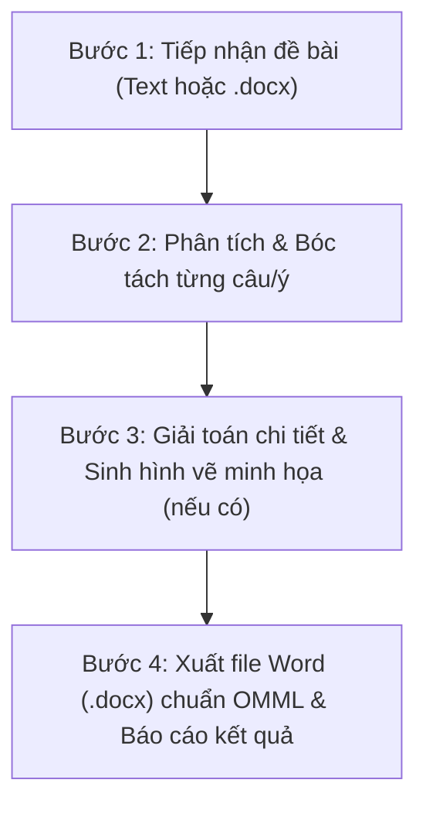

# MathPlus Giải Toán: Bộ Công Cụ Giải Đề & Biên Soạn Lời Giải Toán Học Chuẩn Sư Phạm

## 1. Tổng quan
Skill `mathplus-giai-toan` cung cấp năng lực giải toán toàn diện cho học sinh và giáo viên **MathPlus Academy**:
- **Đầu vào linh hoạt**: Chấp nhận đề bài dạng text thô, markdown, LaTeX hoặc file Word (`.docx`).
- **Giải toán sư phạm**: Trình bày lời giải từng bước, chỉ rõ phương pháp giải, điều kiện xác định, lập luận logic, phản ví dụ (nếu mệnh đề sai) và kết luận nghiệm.
- **Tự động vẽ hình minh họa**: Sử dụng thư viện `matplotlib` sinh các hình vẽ toán học sắc nét (220+ DPI):
  - Biểu diễn khoảng, đoạn, nửa khoảng trên trục số (kèm gạch sọc phần ngoài, ngoặc vuông/tròn).
  - Biểu diễn miền nghiệm bất phương trình, hệ bất phương trình bậc nhất 2 ẩn (vẽ đường thẳng bờ, tô màu nửa mặt phẳng/đa giác nghiệm, xác định các đỉnh).
  - Vẽ đồ thị hàm số bậc nhất, bậc hai parabol, hàm phân thức, trị tuyệt đối.
  - Vẽ đồ thị bài toán ứng dụng thực tế (độ cao chuyển động ném, mô hình tối ưu lợi nhuận kinh doanh...).
- **Định dạng Word chuyên nghiệp chuẩn OMML & Nhận diện MathPlus**:
  - Toàn bộ công thức toán học được chuyển đổi thành **Office Open XML Math (OMML)** - phương trình Word bản địa gõ được, co giãn chuẩn xác, không dùng ảnh chụp hay text thô.
  - Hỗ trợ định dạng Markdown tự nhiên (`**in đậm**`, `*in nghiêng*`) và tự động chuyển đổi sang Run thuộc tính Word (tuyệt đối không để sót các ký tự `**` thô).
  - Hỗ trợ chèn hình vẽ trực tiếp vào đề bài thông qua `add_question_figure` (dành cho các câu hỏi có hình minh họa trong đề: "cho hình vẽ bên dưới...").
  - **Quy chuẩn màu sắc, cỡ chữ & Bố cục**:
    - **Cỡ chữ toàn văn bản tối thiểu 11pt** (`Pt(11)` / `sz=22`): Không sử dụng cỡ chữ nhỏ hơn 11pt cho bất kỳ phần nào (kể cả Header, Footer, lời giải, chú thích).
    - **Chữ màu Đen tuyền tuyệt đối** (`RGBColor(0, 0, 0)` / `#000000`), **nền trắng hoàn toàn** (`#FFFFFF`), tuyệt đối không dùng các màu chữ khác.
    - **Khung lời giải chi tiết (Solution Box)**: Nền trắng, **bỏ hoàn toàn sọc đen bên trái** (không dùng viền trái `w:left`), chữ căn lề tự nhiên rõ ràng, dễ nhìn.
    - **Chèn Logo MathPlus ở Header**: Logo giữ nguyên màu thương hiệu gốc (lấy từ `C:\code\mathplus\public\images\logo.jpg` hoặc `resources/logo.jpg`), đặt tại góc trái Header đầu trang.
    - **Header ở các trang sau**: Chỉ gồm **Logo MathPlus** và tên **Trung tâm MathPlus Academy** (chữ nghiêng 11pt, không viết hoa toàn bộ), bỏ hoàn toàn phần text tiêu đề đề thi phía sau.
    - Header & Footer trang nhã, đánh số trang tự động kèm Hotline `0977 961 189` và chữ ký giáo viên `Nguyễn Văn Dũng`.

---

## 2. Quy trình Thực Hiện 4 Bước của Agent

Khi người dùng yêu cầu giải đề bài hoặc chuyển đề thi sang file Word có lời giải:



### Bước 1: Đọc & Chuẩn hóa đề bài
- Nếu đầu vào là file Word (`.docx`), dùng thư viện `docx` trong Python để trích xuất nội dung văn bản.
- Nếu đầu vào là text, chuẩn hóa các công thức toán học về dạng LaTeX (ví dụ: `\forall x \in \mathbb{R}`, `\sqrt{2x-4}`, `\frac{2x+1}{x-3}`, `\begin{cases} ... \end{cases}`).

### Bước 2: Giải chi tiết từng câu
- Lời giải phải đáp ứng chuẩn sư phạm:
  - **Mệnh đề - Tập hợp**: Nêu rõ tính đúng/sai. Với mệnh đề sai, bắt buộc đưa ra phản ví dụ cụ thể. Các phép toán giao $\cap$, hợp $\cup$, hiệu $\setminus$ phải nêu rõ điều kiện thuộc tập hợp.
  - **Bất phương trình & Hệ BPT hai ẩn**:
    - Nêu phương trình đường thẳng bờ $d$.
    - Lấy điểm thử (thường là gốc tọa độ $O(0; 0)$) để kiểm tra nửa mặt phẳng nghiệm.
    - Với hệ BPT: Tìm tọa độ tất cả các đỉnh giao điểm của đa giác miền nghiệm bằng cách giải từng hệ 2 phương trình bậc nhất.
  - **Hàm số & Parabol**:
    - Tìm tập xác định: Biểu thức dưới căn $\geq 0$, mẫu thức $\neq 0$.
    - Parabol $y = ax^2 + bx + c$: Xác định tọa độ đỉnh $I\left(-\dfrac{b}{2a}; -\dfrac{\Delta}{4a}\right)$, trục đối xứng $x = -\dfrac{b}{2a}$, bề lõm (quay lên nếu $a > 0$, quay xuống nếu $a < 0$), giao điểm với trục $Ox, Oy$ và bảng giá trị điểm đặc trưng.
  - **Bài toán thực tế & Cực trị**:
    - Xác định ý nghĩa các biến số và điều kiện thực tế (thời gian $t \geq 0$, số sản phẩm $x \in \mathbb{N}$).
    - Tìm giá trị lớn nhất / nhỏ nhất bằng cách tìm tọa độ đỉnh parabol hoặc khảo sát trên đoạn cho trước.

### Bước 3: Sinh hình vẽ minh họa tự động
- Xác định các bài toán cần hình ảnh trực quan:
  - Bài toán biểu diễn tập hợp $\implies$ gọi `plot_number_line_intervals`.
  - Bài toán miền nghiệm 1 BPT $\implies$ gọi `plot_linear_inequality`.
  - Bài toán miền nghiệm hệ BPT $\implies$ gọi `plot_linear_system_polygon`.
  - Bài toán vẽ đồ thị parabol $\implies$ gọi `plot_quadratic_parabola`.
  - Bài toán thực tế quỹ đạo / lợi nhuận $\implies$ gọi đồ thị tương ứng.
- Lưu file ảnh vào thư mục `images/` cạnh file Word.

### Bước 4: Đóng gói tài liệu Word qua Engine MathPlus
- Gọi `MathPlusDocxBuilder` từ script `scripts/mathplus_docx_engine.py`:
  - Thêm tiêu đề phiếu, năm học, thời gian làm bài (tự động nạp logo MathPlus ở Header).
  - Thêm các phần kiến thức (Phần I: Bài tập trên lớp, Phần II: Bài tập về nhà).
  - Với mỗi câu, thêm đề bài và khung lời giải (`add_solution` hoặc `add_solution_box`) bao gồm: các bước lập luận, công thức khối, hình vẽ minh họa và chú thích ảnh. Khung lời giải không có sọc đen viền trái, font chữ tối thiểu 11pt.
  - Thêm bảng tự đánh giá và khung nhận xét của giáo viên.
  - Lưu thành 2 file:
    1. Bản đề bài học sinh: `[Tên_Phiếu].docx`
    2. Bản có giải & hình vẽ: `[Tên_Phiếu]_Solved.docx`

---

## 3. Cấu Trúc Mã Nguồn Module Skill

Thư mục skill đặt tại `C:\Users\nguye\.gemini\config\skills\mathplus-giai-toan\` bao gồm:
```
mathplus-giai-toan/
├── SKILL.md                          # Tài liệu hướng dẫn vận hành cho Agent
├── resources/
│   └── logo.jpg                      # Logo MathPlus Academy (giữ nguyên màu gốc khi chèn Header)
├── scripts/
│   ├── omml_converter.py             # Bộ chuyển đổi LaTeX -> OMML XML (Office Math)
│   ├── math_plotter.py               # Thư viện vẽ hình toán học (trục số, Oxy, Parabol)
│   ├── mathplus_docx_engine.py       # Engine dựng tài liệu Word MathPlus chuẩn OpenXML
│   └── cli.py                        # Script CLI điều phối giải đề từ dòng lệnh
└── examples/                         # Đề mẫu & file Word mẫu đã hoàn thành
```

### Sử dụng Engine trong Python Script:
```python
import sys
sys.path.append(r"C:\Users\nguye\.gemini\config\skills\mathplus-giai-toan\scripts")

from mathplus_docx_engine import MathPlusDocxBuilder
from math_plotter import plot_number_line_intervals, plot_linear_inequality

# 1. Khởi tạo tài liệu (chữ đen tuyền, nền trắng, font >= 11pt, logo giữ nguyên màu ở Header)
builder = MathPlusDocxBuilder(
    title="PHIẾU TỔNG ÔN TOÁN 10 – GIỮA HỌC KỲ I",
    subtitle="Năm học 2026 – 2027",
    time_limit="90 phút",
    is_solved=True,
    logo_path=r"C:\code\mathplus\public\images\logo.jpg"
)

# 2. Thêm Phần & Dạng
builder.add_section("PHẦN I. BÀI TẬP TRÊN LỚP", "Giáo viên hướng dẫn, học sinh làm bài.")
builder.add_dang("DẠNG 1. MỆNH ĐỀ – TẬP HỢP")

# 3. Thêm câu hỏi
builder.add_problem_header("Bài 1.", "Cho tập hợp $A = [-2; 3)$ và $B = (1; 5]$. Tìm $A \\cap B$.")

# 4. Thêm lời giải chi tiết kèm hình (không có sọc đen bên trái, font >= 11pt)
builder.add_solution([
    ('title', '✎ LỜI GIẢI CHI TIẾT:'),
    ('p', r"Giao của hai tập hợp là phần tử đồng thời thuộc cả $A$ và $B$:"),
    ('display_math', r"A \cap B = [-2; 3) \cap (1; 5] = (1; 3)."),
    ('bullet', r"Kết luận: Tập hợp nghiệm là $(1; 3)$.")
])

# 5. Lưu file
builder.save(r"C:\code\mathplus\lop10\Ket_Qua.docx")
```

---

## 4. Các Tiêu Chuẩn Bắt Buộc (Rules & Checklist)

1. **Màu sắc & Định dạng**:
   - **Cỡ chữ tối thiểu 11pt**: Toàn bộ văn bản, công thức, bảng biểu, đầu trang và chân trang có cỡ chữ tối thiểu 11pt (`Pt(11)`).
   - **Chữ màu Đen tuyền 100%** (`RGBColor(0, 0, 0)`): Không sử dụng màu xanh, đỏ, vàng, xám cho chữ văn bản hay công thức.
   - **Nền Trắng 100%**: Không tô nền màu (Shading) cho bảng, ô hay khung lời giải.
   - **Không có sọc đen bên trái khung lời giải**: Lời giải trình bày thoáng đẹp, không để viền trái màu đen trên khung lời giải.
   - **Logo MathPlus nguyên màu**: Đặt tại góc trái Header đầu trang.
   - **Header các trang sau**: Chỉ gồm Logo MathPlus và tên `Trung tâm MathPlus Academy` (không viết hoa toàn bộ, 11pt nghiêng), bỏ toàn bộ phần text sau đó.
2. **100% Công thức toán phải dùng OMML**: Tuyệt đối không để nguyên mã LaTeX thô trong văn bản (ví dụ không để `\frac{a}{b}` ở dạng text thường), không dùng ảnh chụp công thức. Toàn bộ công thức nội dòng `$ ... $` hoặc khối `\[ ... \]` đều phải qua `latex_to_omml`.
3. **Hình vẽ minh họa rõ ràng**:
   - Trục tọa độ $Oxy$ phải có mũi tên, gốc $O$, nhãn trục $x, y$.
   - Các điểm đỉnh, điểm đặc trưng phải đánh dấu chấm tròn kèm tọa độ rõ ràng.
   - Hình vẽ phải có chú thích (Caption) chữ nghiêng căn giữa ngay dưới ảnh.
4. **Tuân thủ chuẩn ECMA-376 OpenXML**:
   - Đảm bảo 100% file Word xuất ra mở mượt mà trên Microsoft Word, WPS Office, LibreOffice mà không có bất kỳ thông báo lỗi file nào.
5. **Nhận diện thương hiệu MathPlus Academy**:
   - Luôn có logo MathPlus, thông tin trung tâm ở đầu tài liệu.
   - Luôn có chân trang ghi chú số hotline `0977 961 189` và chữ ký giáo viên `Nguyễn Văn Dũng`.
