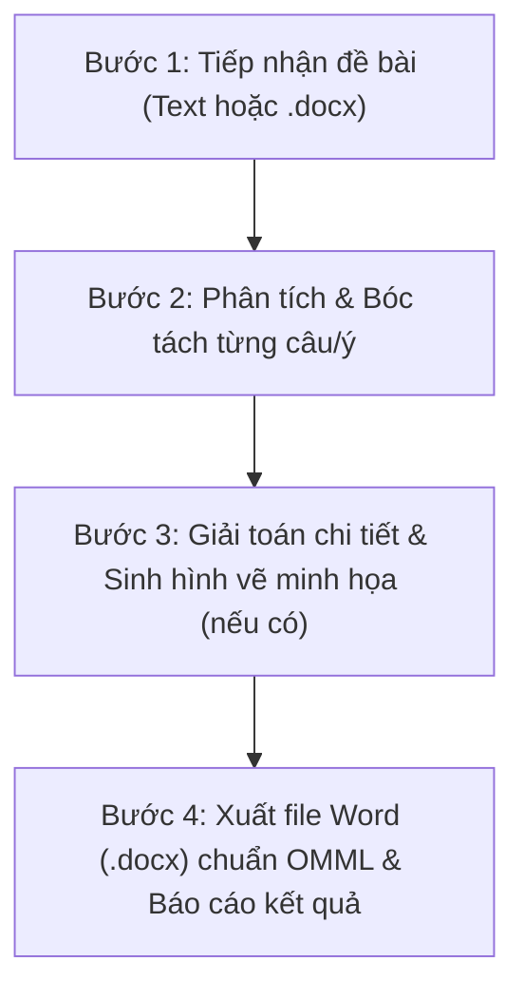

# MathPlus Giải Toán: Bộ Công Cụ Giải Đề & Biên Soạn Lời Giải Toán Học Chuẩn Sư Phạm

## 1. Tổng quan
Skill `mathplus-giai-toan` cung cấp năng lực giải toán toàn diện cho học sinh và giáo viên **MathPlus Academy**:
- **Đầu vào linh hoạt**: Chấp nhận đề bài dạng text thô, markdown, LaTeX hoặc file Word (`.docx`).
- **Giải toán sư phạm**: Trình bày lời giải từng bước, chỉ rõ phương pháp giải, điều kiện xác định, lập luận logic, phản ví dụ (nếu mệnh đề sai) và kết luận nghiệm.
- **Tự động vẽ hình minh họa**: Sử dụng thư viện `matplotlib` sinh các hình vẽ toán học sắc nét (220+ DPI):
  - Biểu diễn khoảng, đoạn, nửa khoảng trên trục số (kèm gạch sọc phần ngoài, ngoặc vuông/tròn).
  - Biểu diễn miền nghiệm bất phương trình, hệ bất phương trình bậc nhất 2 ẩn (vẽ đường thẳng bờ, tô màu nửa mặt phẳng/đa giác nghiệm, xác định các đỉnh).
  - Vẽ đồ thị hàm số bậc nhất, bậc hai parabol, hàm phân thức, trị tuyệt đối.
  - Vẽ đồ thị bài toán ứng dụng thực tế (độ cao chuyển động ném, mô hình tối ưu lợi nhuận kinh doanh...).
- **Định dạng Word chuyên nghiệp chuẩn OMML**:
  - Toàn bộ công thức toán học được chuyển đổi thành **Office Open XML Math (OMML)** - phương trình Word bản địa gõ được, co giãn chuẩn xác, không dùng ảnh chụp hay text thô.
  - Thiết kế chuẩn thương hiệu MathPlus Academy (Header 2 cột trang nhã, khung học sinh, khung bài tập, khung lời giải viền xanh navy, bảng tự đánh giá học sinh, nhận xét giáo viên, footer đánh số trang tự động).

---

## 2. Quy trình Thực Hiện 4 Bước của Agent

Khi người dùng yêu cầu giải đề bài hoặc chuyển đề thi sang file Word có lời giải:



### Bước 1: Đọc & Chuẩn hóa đề bài
- Nếu đầu vào là file Word (`.docx`), dùng thư viện `docx` trong Python để trích xuất nội dung văn bản.
- Nếu đầu vào là text, chuẩn hóa các công thức toán học về dạng LaTeX (ví dụ: `\forall x \in \mathbb{R}`, `\sqrt{2x-4}`, `\frac{2x+1}{x-3}`, `\begin{cases} ... \end{cases}`).

### Bước 2: Giải chi tiết từng câu
- Lời giải phải đáp ứng chuẩn sư phạm:
  - **Mệnh đề - Tập hợp**: Nêu rõ tính đúng/sai. Với mệnh đề sai, bắt buộc đưa ra phản ví dụ cụ thể. Các phép toán giao $\cap$, hợp $\cup$, hiệu $\setminus$ phải nêu rõ điều kiện thuộc tập hợp.
  - **Bất phương trình & Hệ BPT hai ẩn**:
    - Nêu phương trình đường thẳng bờ $d$.
    - Lấy điểm thử (thường là gốc tọa độ $O(0; 0)$) để kiểm tra nửa mặt phẳng nghiệm.
    - Với hệ BPT: Tìm tọa độ tất cả các đỉnh giao điểm của đa giác miền nghiệm bằng cách giải từng hệ 2 phương trình bậc nhất.
  - **Hàm số & Parabol**:
    - Tìm tập xác định: Biểu thức dưới căn $\geq 0$, mẫu thức $\neq 0$.
    - Parabol $y = ax^2 + bx + c$: Xác định tọa độ đỉnh $I\left(-\dfrac{b}{2a}; -\dfrac{\Delta}{4a}\right)$, trục đối xứng $x = -\dfrac{b}{2a}$, bề lõm (quay lên nếu $a > 0$, quay xuống nếu $a < 0$), giao điểm với trục $Ox, Oy$ và bảng giá trị điểm đặc trưng.
  - **Bài toán thực tế & Cực trị**:
    - Xác định ý nghĩa các biến số và điều kiện thực tế (thời gian $t \geq 0$, số sản phẩm $x \in \mathbb{N}$).
    - Tìm giá trị lớn nhất / nhỏ nhất bằng cách tìm tọa độ đỉnh parabol hoặc khảo sát trên đoạn cho trước.

### Bước 3: Sinh hình vẽ minh họa tự động
- Xác định các bài toán cần hình ảnh trực quan:
  - Bài toán biểu diễn tập hợp $\implies$ gọi `plot_number_line_intervals`.
  - Bài toán miền nghiệm 1 BPT $\implies$ gọi `plot_linear_inequality`.
  - Bài toán miền nghiệm hệ BPT $\implies$ gọi `plot_linear_system_polygon`.
  - Bài toán vẽ đồ thị parabol $\implies$ gọi `plot_quadratic_parabola`.
  - Bài toán thực tế quỹ đạo / lợi nhuận $\implies$ gọi đồ thị tương ứng.
- Lưu file ảnh vào thư mục `images/` cạnh file Word.

### Bước 4: Đóng gói tài liệu Word qua Engine MathPlus
- Gọi `MathPlusDocxBuilder` từ script `scripts/mathplus_docx_engine.py`:
  - Thêm tiêu đề phiếu, năm học, thời gian làm bài.
  - Thêm các phần kiến thức (Phần I: Bài tập trên lớp, Phần II: Bài tập về nhà).
  - Với mỗi câu, thêm đề bài và khung lời giải (`add_solution`) bao gồm: các bước lập luận, công thức khối, hình vẽ minh họa và chú thích ảnh.
  - Thêm bảng tự đánh giá và khung nhận xét của giáo viên.
  - Lưu thành 2 file:
    1. Bản đề bài học sinh: `[Tên_Phiếu].docx`
    2. Bản có giải & hình vẽ: `[Tên_Phiếu]_Solved.docx`

---

## 3. Cấu Trúc Mã Nguồn Module Skill

Thư mục skill đặt tại `/Volumes/data/code/skills/mathplus-giai-toan/` bao gồm:
```
mathplus-giai-toan/
├── SKILL.md                          # Tài liệu hướng dẫn vận hành cho Agent
├── scripts/
│   ├── omml_converter.py             # Bộ chuyển đổi LaTeX -> OMML XML (Office Math)
│   ├── math_plotter.py               # Thư viện vẽ hình toán học (trục số, Oxy, Parabol)
│   ├── mathplus_docx_engine.py       # Engine dựng tài liệu Word MathPlus chuẩn OpenXML
│   └── cli.py                        # Script CLI điều phối giải đề từ dòng lệnh
└── examples/                         # Đề mẫu & file Word mẫu đã hoàn thành
```

### Sử dụng Engine trong Python Script:
```python
import sys
sys.path.append("/Volumes/data/code/skills/mathplus-giai-toan/scripts")

from mathplus_docx_engine import MathPlusDocxBuilder
from math_plotter import plot_number_line_intervals, plot_linear_inequality

# 1. Khởi tạo tài liệu
builder = MathPlusDocxBuilder(
    title="PHIẾU TỔNG ÔN TOÁN 10 – GIỮA HỌC KỲ I",
    subtitle="Năm học 2026 – 2027",
    time_limit="90 phút",
    is_solved=True
)

# 2. Thêm Phần & Dạng
builder.add_section("PHẦN I. BÀI TẬP TRÊN LỚP", "Giáo viên hướng dẫn, học sinh làm bài.")
builder.add_dang("DẠNG 1. MỆNH ĐỀ – TẬP HỢP")

# 3. Thêm câu hỏi
builder.add_problem_header("Bài 1.", "Cho tập hợp $A = [-2; 3)$ và $B = (1; 5]$. Tìm $A \\cap B$.")

# 4. Thêm lời giải chi tiết kèm hình
builder.add_solution([
    ('title', ''),
    ('p', r"Giao của hai tập hợp là phần tử đồng thời thuộc cả $A$ và $B$:"),
    ('display_math', r"A \cap B = [-2; 3) \cap (1; 5] = (1; 3)."),
    ('bullet', r"Kết luận: Tập hợp nghiệm là $(1; 3)$.")
])

# 5. Lưu file
builder.save("/Volumes/data/code/mathplus/Toán cấp 3/Ket_Qua.docx")
```

---

## 4. Các Tiêu Chuẩn Bắt Buộc (Rules & Checklist)

1. **100% Công thức toán phải dùng OMML**: Tuyệt đối không để nguyên mã LaTeX thô trong văn bản (ví dụ không để `\frac{a}{b}` ở dạng text thường), không dùng ảnh chụp công thức. Toàn bộ công thức nội dòng `$ ... $` hoặc khối `\[ ... \]` đều phải qua `latex_to_omml`.
2. **Hình vẽ minh họa rõ ràng**:
   - Trục tọa độ $Oxy$ phải có mũi tên, gốc $O$, nhãn trục $x, y$.
   - Các điểm đỉnh, điểm đặc trưng phải đánh dấu chấm tròn đỏ kèm tọa độ rõ ràng.
   - Hình vẽ phải có chú thích (Caption) chữ nghiêng căn giữa ngay dưới ảnh.
3. **Tuân thủ chuẩn ECMA-376 OpenXML**:
   - Sau khi tạo file Word, kiểm tra bằng script kiểm tra schema:
     `python3 /Users/hoangnd/.gemini/config/skills/docx/scripts/office/validate.py output.docx`
   - Đảm bảo đạt trạng thái: `All validations PASSED!`.
4. **Nhận diện thương hiệu MathPlus Academy**:
   - Luôn có thông tin trung tâm ở đầu tài liệu.
   - Luôn có chân trang ghi chú số hotline `0977 961 189` và chữ ký giáo viên `Nguyễn Văn Dũng`.
