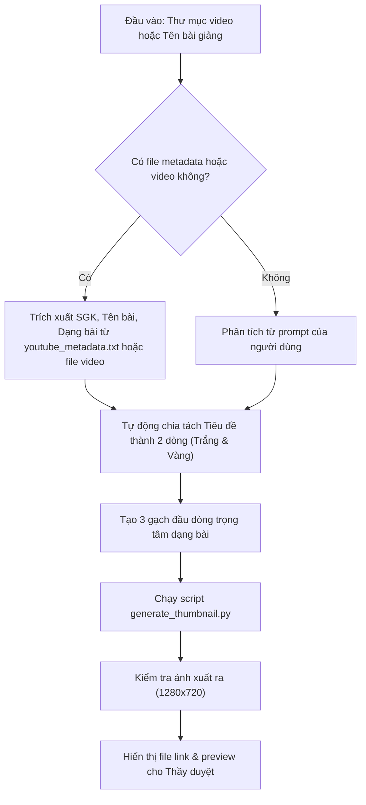

# MathPlus Tạo Ảnh Thumbnail YouTube: Chuẩn Nhận Diện Thương Hiệu MathPlus Academy

## 1. Tổng quan & Mục đích

Skill `mathplus-tao-anh-thumbnail` cung cấp công cụ tự động tạo ảnh thu nhỏ (YouTube Thumbnail) chuyên nghiệp, đồng bộ 100% nhận diện thương hiệu cho kênh **Học Toán Cùng Thầy Hoàng - Mathplus**.

### Tiêu chuẩn kỹ thuật Thumbnail:
* **Kích thước chuẩn:** 1280 × 720 pixel (Tỷ lệ vàng 16:9 của YouTube).
* **Định dạng & Dung lượng:** PNG/JPG chất lượng cao (< 2MB), load cực nhanh trên mọi thiết bị.
* **Tối ưu Mobile First (CTR cao):**
  * Tiêu đề chữ khổng lồ (78pt), tương phản cực mạnh giữa Trắng `#FFFFFF` & Vàng Neon `#FFD600` với đổ bóng đen sâu.
  * Góc dưới bên phải (x: 1100-1280, y: 660-720) luôn được chừa thoáng, **không bao giờ bị nhãn thời lượng video (ví dụ: `36:22`) của YouTube che khuất**.
  * Chân dung Thầy Hoàng dùng **ảnh thật 100%** (không dùng AI ảo), viền hào quang kép (Vàng & Xanh lục bảo) tạo uy tín và độ nhận diện tức thì.

---

## 2. Hệ Màu Sắc & Bố Cục Chuẩn MathPlus

| Thành phần | Mã màu / Kích thước | Mô tả trực quan |
| :--- | :--- | :--- |
| **Nền chính (Background)** | Gradient `#05180c` $\rightarrow$ `#103b1c` | Xanh lục bảo đậm công nghệ, sang trọng, chiều sâu cao |
| **Lưới tọa độ (Math Grid)** | Xanh ngọc `#00e676` (alpha 14/255) | Ô vuông 45px gợi cảm giác không gian toán học |
| **Hào quang chân dung** | Xanh `#00c853` (85) & Vàng `#ffd600` (60) | Vệt sáng tròn đa lớp mờ 65px phía sau ảnh thầy |
| **Khung ảnh chân dung** | Đường kính 530px | Viền ngoài vàng `#ffd600`, viền trong xanh `#00e676` |
| **Thẻ chương trình (Top Pill)** | Nền đỏ `#d32f2f`, viền `#ffcdd2` | Ví dụ: `TOÁN 11 - KẾT NỐI TRI THỨC` |
| **Tiêu đề Dòng 1** | Trắng `#FFFFFF` (Arial Bold 78pt) | Đổ bóng đen sâu 6px (ví dụ: `GIỚI HẠN`) |
| **Tiêu đề Dòng 2** | Vàng Neon `#FFD600` (Arial Bold 78pt) | Đổ bóng đen sâu 6px (ví dụ: `DÃY SỐ`) |
| **Hộp nội dung (Feature Card)** | Nền mờ `rgba(8, 36, 20, 0.82)` | Viền xanh `#00e676`, 3 gạch đầu dòng 3 màu |
| **Nút kêu gọi (Hook Badge)** | Cam rực `#ff6f00`, viền vàng `#ffe082` | Ngôi sao vàng $\bigstar$ + Text `NẮM TRỌN ĐIỂM 9 - 10` |
| **Huy hiệu tên thầy** | Xanh rừng `#1b5e20`, viền vàng `#ffd600` | `THẦY HOÀNG • MATHPLUS` |

---

## 3. Quy trình Trích xuất Nội dung & Sinh Thumbnail

Khi người dùng yêu cầu tạo thumbnail cho một video (ví dụ: `v001`, `v002`, `v003`...):



### Cách bóc tách nội dung bài giảng:
1. **Curriculum (Thẻ bộ sách & Lớp):**
   * Lớp 10: `TOÁN 10 - KẾT NỐI TRI THỨC` / `CÁNH DIỀU` / `CHÂN TRỜI SÁNG TẠO`
   * Lớp 11: `TOÁN 11 - KẾT NỐI TRI THỨC` / `CÁNH DIỀU` / `CHÂN TRỜI SÁNG TẠO`
   * Lớp 12: `TOÁN 12 - KẾT NỐI TRI THỨC` / `CÁNH DIỀU` / `CHÂN TRỜI SÁNG TẠO`
   * Luyện thi: `LUYỆN THI TỐT NGHIỆP THPT QUỐC GIA` / `LUYỆN THI ĐÁNH GIÁ NĂNG LỰC`
2. **Subtitle (Phụ đề bài học):**
   * Dạng `BÀI [Số]: CHUYÊN ĐỀ` hoặc `CHUYÊN ĐỀ TRỌNG TÂM`
3. **Tiêu đề 2 dòng đối xứng (Title L1 & L2):**
   * Dòng 1 (Trắng): Cụm từ định danh (VD: `GIỚI HẠN`, `KHẢO SÁT`, `NGUYÊN HÀM`, `HÌNH HỌC`)
   * Dòng 2 (Vàng): Trọng tâm chuyên sâu (VD: `HÀM SỐ`, `DÃY SỐ`, `TÍCH PHÂN`, `KHÔNG GIAN`)
4. **3 Gạch đầu dòng (Feature Points):**
   * Điểm 1 (Chấm xanh): Dạng bài cốt lõi (VD: `3 Dạng Vô Định Kinh Điển (0/0, ∞/∞)`)
   * Điểm 2 (Chấm vàng): Tuyệt chiêu xử lý nhanh / mẹo liên hợp (VD: `Mẹo Khử Căn & Nhân Liên Hợp Nhanh`)
   * Điểm 3 (Chấm cyan): Kỹ thuật Casio & Tự luận đạt điểm tối đa (VD: `Phương Pháp Casio & Tự Luận Điểm 10`)
5. **Nút cam (Hook):**
   * `NẮM TRỌN ĐIỂM 9 - 10`
   * `BỨT PHÁ ĐIỂM 9+`
   * `MẸO GIẢI NHANH 30 GIÂY`

---

## 4. Cách sử dụng Script `generate_thumbnail.py`

Script nằm tại: `/Volumes/data/code/skills/mathplus-tao-anh-thumbnail/scripts/generate_thumbnail.py`

### Lệnh tạo cơ bản (Tự động đọc thư mục video):
```bash
python3 /Volumes/data/code/skills/mathplus-tao-anh-thumbnail/scripts/generate_thumbnail.py \
    --video-folder /Volumes/data/code/YoutubeDayToan/v002
```

### Lệnh tạo thủ công với đầy đủ tham số:
```bash
python3 /Volumes/data/code/skills/mathplus-tao-anh-thumbnail/scripts/generate_thumbnail.py \
    --curriculum "TOÁN 11 - KẾT NỐI TRI THỨC" \
    --subtitle "BÀI 16: CHUYÊN ĐỀ" \
    --title-l1 "GIỚI HẠN" \
    --title-l2 "HÀM SỐ" \
    --bullets "3 Dạng Vô Định Kinh Điển (0/0, ∞/∞)|Mẹo Khử Căn & Nhân Liên Hợp Nhanh|Tuyệt Kỹ Casio & Trình Bày Tự Luận Điểm 10" \
    --hook "NẮM TRỌN ĐIỂM 9 - 10" \
    --slogan "Bám sát cấu trúc đề thi mới nhất • Tự tin giành điểm tối đa!" \
    --output "/Volumes/data/code/YoutubeDayToan/v002/thumbnail_v002.png"
```

### Nếu Thầy cung cấp ảnh chân dung mới (.HEIC hoặc .JPG):
Script tích hợp sẵn công nghệ bóc tách chủ thể bằng Apple Vision (`cutout_person.swift`), chỉ cần truyền:
```bash
python3 /Volumes/data/code/skills/mathplus-tao-anh-thumbnail/scripts/generate_thumbnail.py \
    --teacher-img "/path/to/IMG_xxxx.HEIC" \
    --title "Hàm Số Liên Tục" \
    --output "/Volumes/data/code/YoutubeDayToan/v003/thumbnail_v003.png"
```

---

## 5. Tài nguyên có sẵn trong Skill

* `resources/thay_hoang_master.png`: File chân dung gốc của Thầy Hoàng đã bóc tách nền chuẩn xác, sắc nét, có thể tái sử dụng ngay lập tức cho tất cả video sau này mà không cần cắt lại.
* `resources/sample_thumbnail.png`: Ảnh mẫu đối chiếu chuẩn phong cách MathPlus.
