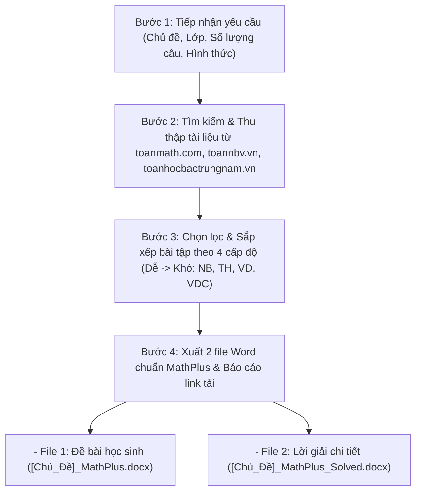

# MathPlus Tạo Bài Tập Toán Cấp 3: Bộ Công Cụ Tự Động Thu Thập & Biên Soạn Phiếu Bài Tập Phân Hóa

## 1. Tổng quan & Mục đích

Skill `mathplus-tao-bai-tap-toan-cap3` cung cấp năng lực toàn diện cho giáo viên và trợ lý học tập tại **Trung tâm MathPlus Academy**:
- **Thu thập từ các nguồn web Toán uy tín**: Tự động tìm kiếm, quét bài viết, chuyên đề và tài liệu PDF/Docx từ:
  - `https://toanmath.com` (kho đề thi và chuyên đề Toán đồ sộ cập nhật liên tục)
  - `https://www.toannbv.vn` (Toán Ninh Bình VIP - Thầy Nguyễn Bá Việt)
  - `https://toanhocbactrungnam.vn` (Toán học Bắc Trung Nam - kho tài liệu luyện thi THPT)
  - Cùng các nguồn học liệu Toán THPT bám sát chương trình GDPT 2018.
- **Phân loại nội dung từ dễ đến khó**:
  - Tự động sắp xếp và phân nhóm các câu hỏi theo 4 cấp độ tư duy chuẩn của Bộ GD&ĐT:
    1. **Mức 1: Nhận biết (Dễ)**: Định nghĩa, công thức cơ bản, nhận diện đồ thị, bảng biến thiên trực tiếp (~35%).
    2. **Mức 2: Thông hiểu (Trung bình)**: Biến đổi 1-2 bước, giải phương trình/bất phương trình cơ bản, tìm tham số đơn giản (~30%).
    3. **Mức 3: Vận dụng (Khá)**: Tổng hợp phương pháp, điều kiện có nghiệm phức tạp, cực trị, hình học không gian (~20%).
    4. **Mức 4: Vận dụng cao (Nâng cao / Phân hóa)**: Bài toán ứng dụng thực tế tối ưu, cực trị chứa tham số, bài toán phân loại 9 - 10 điểm (~15%).
- **Linh hoạt hình thức câu hỏi (GDPT 2018)**:
  - Trắc nghiệm nhiều phương án lựa chọn (A, B, C, D).
  - Trắc nghiệm Đúng / Sai (4 ý a, b, c, d theo format kỳ thi Tốt nghiệp THPT mới).
  - Trắc nghiệm trả lời ngắn (điền kết quả).
  - Tự luận truyền thống kèm các bước lập luận sư phạm chặt chẽ.
- **Số lượng bài tập tùy chỉnh**: Người dùng chủ động chỉ định số lượng (ví dụ: 10 câu, 20 câu, 30 câu, 50 câu...).
- **Đầu ra chuẩn mực Word (.docx)**:
  - Tự động xuất **đồng thời 2 file Word**:
    1. `[Chủ_Đề]_Lop[X]_MathPlus.docx`: Bản đề bài dành cho học sinh làm bài (kèm thông tin họ tên, lớp, điểm số).
    2. `[Chủ_Đề]_Lop[X]_MathPlus_Solved.docx`: Bản giáo viên gồm **Bảng đáp án trắc nghiệm nhanh** và **Khung lời giải chi tiết từng câu**.

---

## 2. Quy Chuẩn Thương Hiệu MathPlus Academy & Thầy Dũng

Mọi file Word (.docx) được tạo ra bắt buộc phải tuân thủ nghiêm ngặt các quy tắc thẩm mỹ và nhận diện:

1. **Logo MathPlus Academy**:
   - Sử dụng file logo gốc tại `resources/logo.jpg` (hoặc `C:\code\mathplus\public\images\logo.jpg` / `/Volumes/data/code/mathplus/public/images/logo.jpg`).
   - Giữ nguyên màu thương hiệu gốc (xanh lá `#0F8A3C` + cam `#EA580C`), không đổi sang đen trắng.
   - Kích thước:
     - Header các trang sau: Rộng `7.5 mm`.
     - Top Banner trang đầu: Rộng `18.0 mm`.
2. **Thông tin Giáo viên & Trung tâm**:
   - Tên giáo viên: `Thầy Nguyễn Văn Dũng` (hoặc `Nguyễn Văn Dũng`).
   - Tên trung tâm: `Trung tâm MathPlus Academy`.
   - Hotline: `0977 961 189`.
   - Website: `mathplus.com.vn`.
3. **Typography & Màu sắc**:
   - Phông chữ chuẩn: `Times New Roman`.
   - Cỡ chữ toàn văn bản: **Tối thiểu 11pt** (`Pt(11)` / `sz=22`), không sử dụng cỡ chữ nhỏ hơn 11pt cho bất kỳ phần nào (kể cả Header, Footer, lời giải, chú thích).
   - Màu chữ: **Màu Đen tuyền tuyệt đối** (`RGBColor(0, 0, 0)` / `#000000`).
   - Nền: **Nền Trắng 100%** (`#FFFFFF`), không tô màu mè làm tối trang in.
4. **Khung lời giải chi tiết (Solution Box)**:
   - Nền trắng, **BỎ HOÀN TOÀN sọc đen bên trái** (không dùng viền trái `w:left`), chữ căn lề tự nhiên rõ ràng, thẩm mỹ.
5. **Công thức Toán học chuẩn OMML**:
   - **100% công thức toán học** được chuyển đổi sang **Office Open XML Math (OMML)** thông qua stylesheet XSLT chính thức của Word.
   - Tuyệt đối không để mã LaTeX thô (`\frac{a}{b}`, `$x^2$`) trong văn bản hiển thị cho người dùng, không chụp ảnh công thức.
6. **Hệ thống Header & Footer**:
   - Top Banner trang đầu: Bảng 2 cột cân đối (Cột trái: Logo MathPlus + Tên trung tâm + Hotline; Cột phải: Tiêu đề chuyên đề + Lớp + Thông tin Thầy Dũng + Khung họ tên học sinh).
   - Header trang 2 trở đi: Chỉ gồm Logo MathPlus nhỏ (`7.5mm`) và tên `Trung tâm MathPlus Academy` (in nghiêng 11pt), không lặp lại dòng tiêu đề đề thi.
   - Footer tất cả các trang: `Giáo viên: Thầy Nguyễn Văn Dũng – MathPlus Academy | Hotline: 0977 961 189` (bên trái) và `Trang [PAGE]` (bên phải bằng mã trường động `PAGE`).

---

## 3. Quy Trình Vận Hành 4 Bước của Agent



### Bước 1: Tiếp nhận và xác định yêu cầu
- Xác định chủ đề (ví dụ: *Hàm số bậc hai*, *Ứng dụng đạo hàm khảo sát hàm số*, *Hình học không gian Oxyz*, *Phương trình mũ và logarit*, *Xác suất và biến cố*...).
- Xác định khối lớp: Lớp 10, Lớp 11 hoặc Lớp 12 (tự động nhận diện nếu người dùng không ghi rõ).
- Xác định số lượng câu hỏi $N$ do người dùng chỉ định (mặc định 20 câu nếu không yêu cầu cụ thể).
- Xác định hình thức: Trắc nghiệm 4 lựa chọn, Đúng/Sai, Trả lời ngắn hoặc Tự luận.

### Bước 2: Quét và thu thập tài liệu từ các trang web
- Chạy module crawler `math_crawler.py` để tìm kiếm tài liệu theo từ khóa trên các trang:
  - `toanmath.com/?s=[từ_khóa]`
  - `toannbv.vn/search?q=[từ_khóa]`
  - `toanhocbactrungnam.vn/seek/?q=[từ_khóa]`
- Tổng hợp danh sách tài liệu tham khảo, các dạng toán trọng tâm và link tải tài liệu/PDF.

### Bước 3: Biên soạn và phân cấp độ bài tập từ Dễ đến Khó
- Tính toán phân bổ số lượng câu theo tỉ lệ chuẩn sư phạm:
  - **Mức 1: Nhận biết**: $\approx 35\%$ tổng số câu.
  - **Mức 2: Thông hiểu**: $\approx 30\%$ tổng số câu.
  - **Mức 3: Vận dụng**: $\approx 20\%$ tổng số câu.
  - **Mức 4: Vận dụng cao**: $\approx 15\%$ tổng số câu.
- Biên soạn nội dung câu hỏi chuẩn xác, các phương án nhiễu logic, công thức toán học chuẩn LaTeX, đáp án đúng và lời giải chi tiết từng bước.

### Bước 4: Đóng gói và xuất tài liệu Word chuẩn MathPlus
- Gọi `generate_mathplus_worksheets` từ `scripts/cli.py` hoặc sử dụng trực tiếp `MathPlusWorksheetBuilder`.
- Tạo file đề bài cho học sinh và file đáp án có bảng tổng hợp và khung lời giải chi tiết.
- Trả về đường dẫn clickable link dạng `file:///` cho người dùng.

---

## 4. Cấu Trúc Thư Mục Skill

Thư mục skill đặt tại: `/Volumes/data/code/skills/mathplus-tao-bai-tap-toan-cap3/` (và symlink tại `/Users/hoangnd/.gemini/config/skills/mathplus-tao-bai-tap-toan-cap3/`)

```
mathplus-tao-bai-tap-toan-cap3/
├── SKILL.md                          # Hướng dẫn chi tiết cho Agent
├── resources/
│   └── logo.jpg                      # Logo MathPlus Academy nguyên màu thương hiệu
└── scripts/
    ├── omml_converter.py             # Bộ chuyển đổi LaTeX -> OMML XML (Office Math)
    ├── math_crawler.py               # Thu thập và tìm kiếm tài liệu từ toanmath, toannbv, toanhocbactrungnam
    ├── docx_builder.py               # Engine dựng tài liệu Word MathPlus chuẩn OpenXML
    └── cli.py                        # CLI thực thi chính
```

---

## 5. Hướng Dẫn Sử Dụng Chi Tiết

### 5.1. Chạy nhanh qua dòng lệnh (CLI)

#### Tạo phiếu bài tập tự động theo chủ đề và số lượng câu:
```bash
python3 /Volumes/data/code/skills/mathplus-tao-bai-tap-toan-cap3/scripts/cli.py \
  --topic "Hàm số bậc hai" \
  --count 20 \
  --output-dir "/Volumes/data/code/mathplus/Toán cấp 3"
```

#### Tạo phiếu ôn tập Toán 12 (Ứng dụng đạo hàm) với 30 câu:
```bash
python3 /Volumes/data/code/skills/mathplus-tao-bai-tap-toan-cap3/scripts/cli.py \
  --topic "Ứng dụng đạo hàm khảo sát hàm số" \
  --grade 12 \
  --count 30 \
  --output-dir "/Volumes/data/code/mathplus/Toán cấp 3"
```

#### Chỉ tìm kiếm tài liệu trên các trang web Toán:
```bash
python3 /Volumes/data/code/skills/mathplus-tao-bai-tap-toan-cap3/scripts/cli.py \
  --topic "Hình học không gian Oxyz" \
  --search-only
```

#### Tạo bài tập từ file JSON do Agent thu thập và tinh chỉnh:
```bash
python3 /Volumes/data/code/skills/mathplus-tao-bai-tap-toan-cap3/scripts/cli.py \
  --topic "Tích phân và ứng dụng" \
  --input-json "/path/to/exercises.json" \
  --output-dir "/Volumes/data/code/mathplus/Toán cấp 3"
```

---

### 5.2. Định Dạng File JSON Bài Tập Đầu Vào (Khi Agent Tùy Biến Câu Hỏi)

Agent có thể lưu danh sách bài tập đã chọn lọc ra file JSON rồi nạp vào `cli.py` với cấu trúc sau:

```json
[
  {
    "index": 1,
    "level_id": 1,
    "level_name": "Nhận biết",
    "question": "Cho hàm số $y = ax^2 + bx + c$ ($a \\neq 0$). Tọa độ đỉnh $I$ của parabol là:",
    "options": [
      "A. $I\\left(-\\dfrac{b}{2a}; -\\dfrac{\\Delta}{4a}\\right)$.",
      "B. $I\\left(-\\dfrac{b}{a}; -\\dfrac{\\Delta}{4a}\\right)$.",
      "C. $I\\left(\\dfrac{b}{2a}; \\dfrac{\\Delta}{4a}\\right)$.",
      "D. $I\\left(-\\dfrac{b}{2a}; \\dfrac{\\Delta}{2a}\\right)$."
    ],
    "answer": "A",
    "solution": [
      ("p", "Theo định nghĩa về hàm số bậc hai trong sách giáo khoa Toán:"),
      ("bullet", "Đồ thị hàm số bậc hai $y = ax^2 + bx + c$ là một parabol có đỉnh $I\\left(-\\dfrac{b}{2a}; -\\dfrac{\\Delta}{4a}\\right)$."),
      ("bullet", "Do đó khẳng định đúng là phương án **A**.")
    ]
  }
]
```

---

### 5.3. Sử dụng dưới dạng Python Module trong mã nguồn:

```python
import sys
sys.path.append(r"/Volumes/data/code/skills/mathplus-tao-bai-tap-toan-cap3/scripts")

from cli import generate_mathplus_worksheets
from math_crawler import search_all_sources

# 1. Tìm kiếm tài liệu từ các trang web
sources = search_all_sources("Hàm số bậc hai", max_per_source=3)

# 2. Tạo tài liệu Word
res = generate_mathplus_worksheets(
    topic="Hàm số bậc hai",
    grade="10",
    total_count=20,
    output_dir="/Volumes/data/code/mathplus/Toán cấp 3"
)

print("File đề bài học sinh:", res['student_file'])
print("File lời giải chi tiết:", res['solved_file'])
```

---

## 6. Tiêu Chuẩn Sư Phạm & Quality Checklist

Mỗi khi thực hiện yêu cầu tạo bài tập Toán cấp 3, Agent cần kiểm tra đầy đủ danh sách kiểm tra sau:

- [x] **Tìm kiếm nguồn**: Đã kiểm tra qua `toanmath.com`, `toannbv.vn`, `toanhocbactrungnam.vn` để bám sát dạng đề thi thực tế hiện hành.
- [x] **Đủ số lượng câu hỏi**: Đúng số lượng $N$ câu người dùng yêu cầu.
- [x] **Đúng thứ tự từ Dễ đến Khó**:
  - Bắt đầu bằng Mức 1: Nhận biết (củng cố lý thuyết, áp dụng công thức trực tiếp).
  - Tiếp theo là Mức 2: Thông hiểu (tính toán cơ bản 1-2 bước).
  - Tiếp theo là Mức 3: Vận dụng (phối hợp kiến thức, tham số $m$).
  - Kết thúc bằng Mức 4: Vận dụng cao (bài toán thực tế, bất đẳng thức, cực trị phân loại).
- [x] **100% Công thức OMML**: Toàn bộ công thức toán nội dòng `$ ... $` và công thức khối đều hiển thị dưới dạng equation Word bản địa, không có mã LaTeX thô trong văn bản.
- [x] **Chuẩn nhận diện MathPlus**:
  - Logo MathPlus nguyên màu thương hiệu tại Top Banner và Header các trang sau.
  - Thông tin: `Thầy Nguyễn Văn Dũng – Hotline: 0977 961 189`.
  - Phông chữ Times New Roman, cỡ chữ $\ge 11\text{pt}$, màu đen tuyền 100%, nền trắng hoàn toàn.
  - Khung lời giải chi tiết không có viền sọc đen bên trái.
  - Đánh số trang tự động ở Footer.
- [x] **Xuất đủ 2 bản**: Cung cấp cả bản đề bài học sinh và bản lời giải chi tiết.
